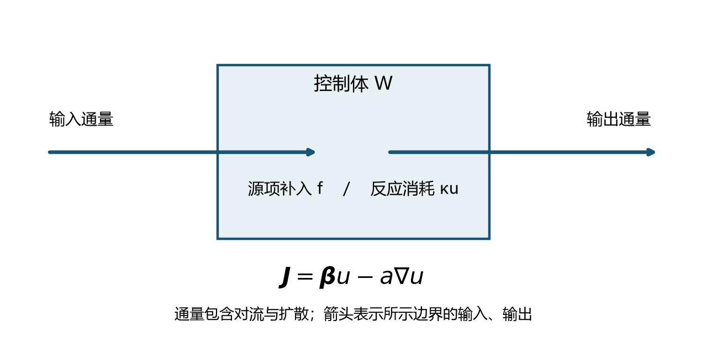

# 稳态输运模型与弱问题

在流动中输运的物质会向低浓度处扩散，也可能因化学反应而消耗。当流入、流出、反应与外部补入达到平衡时，浓度不再随时间变化。这种稳定分布由怎样的方程描述？边界浓度已知以后，方程是否就能唯一确定内部的浓度？

以下在有界区域上讨论浓度的稳态分布，计算时取二维单位正方形。扩散系数和速度场均已给定，浓度是待求函数。本文以 $\boldsymbol{\beta}$ 记给定速度，代码中的 `velocity` 返回该向量场；其一维分量在第三专题记为标量 $b$。

## 从局部守恒建立模型

### 通量、源项与反应

设 $u(\boldsymbol{x})$ 是单位体积的溶质浓度。取区域内任意控制体 $W$，以 $\boldsymbol{n}$ 表示其外法向。若单位界面测度、单位时间通过界面的溶质量由通量 $\boldsymbol{J}$ 描述，那么净流出量为

$$
\int_{\partial W}\boldsymbol{J}\cdot\boldsymbol{n}\,\mathrm ds.
$$

扩散由浓度梯度驱动，采用 Fick 定律 $\boldsymbol{J}_{\mathrm d}=-a\nabla u$，其中 $a>0$。已知速度场 $\boldsymbol{\beta}$ 携带溶质，产生对流通量 $\boldsymbol{J}_{\mathrm a}=u\boldsymbol{\beta}$。若单位体积、单位时间的外部补入为 $f$，一阶反应消耗为 $\kappa u$，稳态下“净流出加反应消耗等于外部补入”：

$$
\int_{\partial W}(-a\nabla u+u\boldsymbol{\beta})\cdot\boldsymbol{n}\,\mathrm ds
+\int_W\kappa u\,\mathrm dx=\int_W f\,\mathrm dx.
$$

控制体的净流出取决于周围通量的变化。即使某一点的扩散通量为零，邻域中的通量仍可能向外张开，使这一点附近具有正的散度。梯度经本构关系给出点上的通量；通量的散度再给出局部守恒关系，因此模型需要保留这两个层次。

利用散度定理，并由控制体的任意性得到守恒形式

$$
-\nabla\cdot(a\nabla u)+\nabla\cdot(\boldsymbol{\beta} u)+\kappa u=f.
\tag{1}
$$

“稳态”表示局部不再积累，并不要求通量为零。只要流入、流出和反应保持平衡，浓度就可以不随时间变化。

展开对流通量，并记 $c=\kappa+\nabla\cdot\boldsymbol{\beta}$，式（1）写成

$$
\boxed{-\nabla\cdot(a\nabla u)+\boldsymbol{\beta}\cdot\nabla u+cu=f.}
\tag{2}
$$

图1　控制体中的总通量、外部补入与反应消耗。

对于散度为零的速度场，$c=\kappa$；对于一般速度场，$c$ 同时包含反应与流场压缩或膨胀的贡献。换用守恒形式时必须同步处理这一项。

方程是线性的，因为 $a,\boldsymbol{\beta},c$ 都是给定的空间函数，不依赖未知量 $u$。扩散系数随空间变化也不会破坏线性，但不能把 $-\nabla\cdot(a\nabla u)$ 简写成 $-a\Delta u$：前者还包含 $-\nabla a\cdot\nabla u$。

### 边界条件完成问题的描述

区域内部的方程还不足以确定解，必须说明区域如何与外部交换物质。规定边界浓度，就是 Dirichlet 条件

$$
u=g\quad\text{on }\partial\Omega.
\tag{3}
$$

全课采用这一全Dirichlet条件。它规定了解在边界上的取值；内部方程则决定满足这些边界值的浓度分布。边界值可以非零，后面需要将这部分已知数据同内部未知量分开处理。

### 材料变化与通量连续

材料不均匀时，浓度梯度与扩散通量之间的比例随位置变化。若 $a$ 足够光滑，强形式展开为

$$
-\nabla\cdot(a\nabla u)=-a\Delta u-\nabla a\cdot\nabla u.
$$

第二项反映材料变化对局部守恒关系的影响。然而在两种材料的接触面上，$a$ 常常直接跳跃，此时逐点使用 $\nabla a$ 已不合适。散度形式与弱形式仍能处理这种情形：只要 $a\in L^\infty$ 且具有严格正下界，扩散积分 $\int a\nabla u\cdot\nabla v$ 就有意义。

假设界面两侧的解分别足够光滑，沿共同法向 $\boldsymbol{n}$ 记两侧迹之差为跳跃。若界面上没有集中源，对两侧子区域分别分部积分，界面贡献必须抵消，因而有

$$
[u]=0,\qquad [a\nabla u\cdot\boldsymbol{n}]=0.
$$

第一个条件由协调 $H^1$ 解给出，第二个条件表达扩散通量连续。若速度场跨界面也变化，应从总通量守恒关系重新确定界面条件，不能仅沿用上述扩散条件。通量连续并不要求梯度连续：在一维恒定通量 $J$ 下，$u'=-J/a$，扩散系数较小的一侧需要更大的梯度才能传递同样的通量。

因此，分片线性近似允许梯度跨单元变化，并非一种缺陷。真正需要区分的是材料界面的物理解结构与数值网格引入的近似。若系数跳跃界面没有被网格解析，求积与误差分析还须考虑界面位置；仅提高求解器精度不能补足这部分信息。

## 一个用于验证的边值问题

选取单位正方形上的常系数问题作为共同算例：

$$
\Omega=(0,1)^2,\qquad a=1,\quad\boldsymbol{\beta}=(1,2)^T,\quad c=1.
\tag{4}
$$

为同时检验三个算子和非零边界，选择光滑函数

$$
u_\star(x,y)=1+\sin(\pi x)\sin(\pi y),\qquad g=1.
\tag{5}
$$

将它代入式（2），得到

$$
\begin{aligned}
f(x,y)={}&(2\pi^2+1)\sin(\pi x)\sin(\pi y)+1\\
&+\pi\cos(\pi x)\sin(\pi y)
+2\pi\sin(\pi x)\cos(\pi y).
\end{aligned}
\tag{6}
$$

先选定解，再由方程构造源项和边界的办法称为制造解。这样能够准确比较数值解与真解，也能检验方程各项是否实现正确。求解器接收的仍然只有模型数据 $f,g$；内部的 $u_\star$ 不作为未知系数输入。实际问题直接给定源项和边界，不要求预先知道真解。

## 弱形式与边界提升

### 从强形式到弱形式

有限元中常用的连续分片一次函数，在每个三角形上都是线性函数。跨过公共边时，函数值连续，梯度却可以跳跃；因而这样的函数通常属于 $H^1$，却不属于 $H^2$。它的二阶导数应按分布理解，不能只在每个单元内部求导后拼在一起。弱形式通过分部积分，把二阶算子表达为分别作用在解和测试函数上的一阶导数，使连续分片函数能够参与求解。

先对足够光滑的函数作形式推导，再以式（7）的连续积分表达定义 $H^1$ 弱解；此时不要求一般弱解具有古典法向导数。取 $v\in H_0^1(\Omega)$，将式（2）乘以 $v$ 并积分。对扩散项使用 Green 公式：

$$
\int_\Omega-\nabla\cdot(a\nabla u)v
=\int_\Omega a\nabla u\cdot\nabla v
-\int_{\partial\Omega}(a\nabla u\cdot\boldsymbol{n})v.
$$

测试函数的边界迹为零，因此最后一项消失。对流项已经只有一阶导数，此处保留原样。记

$$
\begin{aligned}
\mathcal{A}(w,v)&=\int_\Omega a\nabla w\cdot\nabla v
+\int_\Omega(\boldsymbol{\beta}\cdot\nabla w)v
+\int_\Omega cwv,\\
L(v)&=\int_\Omega fv.
\end{aligned}
\tag{7}
$$

由此得到弱问题：在所有具有边界迹 $g$ 的 $H^1$ 函数中求 $u$，使 $\mathcal{A}(u,v)=L(v)$ 对每个 $v\in H_0^1(\Omega)$ 成立。测试函数在边界上的限制来自已给定的边界浓度；允许改变的是内部的函数值。每个测试函数都在自己的支撑区域内衡量加权平衡；分片函数的梯度仍可跨边跳跃，改变的是方程所要求的导数及满足方式。

### 通量边界的对照

作为与全 Dirichlet 条件的对照，设边界分为给定浓度的 $\Gamma_D$ 与给定通量的 $\Gamma_N$，测试函数仅在 $\Gamma_D$ 上为零。若在 $\Gamma_N$ 上规定 $a\nabla u\cdot\boldsymbol{n}=h_N$，弱形式右端会出现 $\int_{\Gamma_N}h_Nv\,\mathrm ds$。这里 $h_N$ 是加权法向导数；若规定的是物理扩散流出量 $q_N=-a\nabla u\cdot\boldsymbol{n}$，右端应写成 $-\int_{\Gamma_N}q_Nv\,\mathrm ds$。总通量还包含 $u\boldsymbol{\beta}$，不能与这两个量混用。下文不采用这组混合边界，测试函数在整个边界上为零。

### 解空间中的边界条件

将边界条件写为 $u=g$，在弱问题中应理解为迹的相等。记迹算子为 $\gamma:H^1(\Omega)\to H^{1/2}(\partial\Omega)$，那么满足边界数据的集合是

$$
V_g=\{v\in H^1(\Omega):\gamma v=g\},\qquad
V=\ker\gamma=H_0^1(\Omega).
$$

这里假设 $g$ 具有 $H^1$ 提升，因而 $V_g$ 非空；在有界Lipschitz区域上，$g\in H^{1/2}(\partial\Omega)$ 是一种标准的数据条件。$V$ 是线性空间，$V_g$ 一般只是仿射空间：两个具有同一非零边界值的函数相加后，边界值成为 $2g$；它们的差却属于 $V$。这正是求解在 $V_g$ 中进行、测试在 $V$ 中进行的原因。

试探函数满足物理边界值，测试函数描述保持边界值不变的允许变化。若把测试空间也取为 $V_g$，非零边界下就失去了线性测试结构。提升将仿射问题转成线性空间上的问题，因而既便于理论证明，也为离散中的边界消元提供了统一解释。

在制造解中，$u_\star|_{\partial\Omega}=1$，故 $V_g=1+V$。取 $w=u-1$ 后，边界齐次，并且

$$
\mathcal{A}(w,v)=\int_\Omega(f-1)v\,\mathrm dx.
$$

其余系数没有改变。对流只作用于梯度，常数提升不产生对流贡献；反应直接作用于函数值，因而留下右端中的 $-1$。这一小计算可以在没有矩阵的阶段核对边界数据是否进入了正确的算子。

### 边界提升

设 $V=H_0^1(\Omega)$。当 $g\ne0$ 时，解不属于 $V$。取一个边界提升 $\ell\in H^1(\Omega)$，使其迹为 $g$，写成

$$
u=\ell+w,\qquad w\in V.
$$

那么问题等价于

$$
\boxed{\mathcal{A}(w,v)=L(v)-\mathcal{A}(\ell,v),\quad\forall v\in V.}
\tag{8}
$$

提升 $\ell$ 先满足边界数据，余下的 $w$ 具有零迹，因此可以在同一个线性空间中求解和测试。提升并不唯一；不同选择改变的是已知部分与待求修正的划分，最终恢复的 $u$ 应相同。下面的唯一性论证会同时说明这一点。

对于式（5），可以取 $\ell=1$。它的梯度为零，所以 $\mathcal{A}(1,v)=\int_\Omega v$，提升后的右端是 $\int_\Omega(f-1)v$。注意即使边界只是一个常数，它仍通过反应项进入内部方程。这一关系稍后会变成矩阵中的边界列移项。

## 弱问题的适定性

弱形式降低了对解的光滑性要求，但并非任意系数都能保证问题可解。关键在于扩散提供的控制是否足以约束函数的大小。下面给出的条件使双线性型连续且强制，从而可以使用Lax–Milgram定理。

**命题。** 设 $\Omega$ 是有界 Lipschitz 区域，$a,c\in L^\infty(\Omega)$，$a\ge a_0>0$，$\boldsymbol{\beta}\in W^{1,\infty}(\Omega)^d$，且

$$
c-\tfrac12\nabla\cdot\boldsymbol{\beta}\ge0\quad\text{几乎处处成立}.
\tag{9}
$$

若 $f\in L^2(\Omega)$，并且 $g$ 具有 $H^1$ 提升，则弱问题有唯一解，解连续依赖于右端和提升。

### 连续性与强制性

在 $V$ 上取范数 $\|v\|_V=\|\nabla v\|_{L^2}$。Poincaré 不等式给出 $\|v\|_{L^2}\le C_P\|v\|_V$。对 $w,v\in V$，Cauchy–Schwarz 不等式说明

$$
|\mathcal{A}(w,v)|\le
\bigl(\|a\|_\infty+C_P\|\boldsymbol{\beta}\|_\infty+C_P^2\|c\|_\infty\bigr)
\|w\|_V\|v\|_V.
\tag{10}
$$

所以双线性型连续，记括号中的常数为 $C_A$。再看 $\mathcal{A}(v,v)$。由于 $v$ 的边界迹为零，

$$
\int_\Omega(\boldsymbol{\beta}\cdot\nabla v)v
=\frac12\int_\Omega\boldsymbol{\beta}\cdot\nabla(v^2)
=-\frac12\int_\Omega(\nabla\cdot\boldsymbol{\beta})v^2.
$$

于是

$$
\mathcal{A}(v,v)
=\int_\Omega a|\nabla v|^2
+\int_\Omega\left(c-\tfrac12\nabla\cdot\boldsymbol{\beta}\right)v^2
\ge a_0\|v\|_V^2.
\tag{11}
$$

这称为强制性。连续性控制双线性型的上界，强制性给出正的下界。下面分别说明解是否存在、是否唯一，以及数据变化时解怎样变化。

### 存在性

提升后的问题在 Hilbert 空间 $V$ 上求解。对任意 $v\in V$，有

$$
|L(v)|\le C_P\|f\|_{L^2}\|v\|_V,
\qquad
|\mathcal A(\ell,v)|\le C_\ell\|\ell\|_{H^1}\|v\|_V,
$$

其中可取 $C_\ell=\|a\|_\infty+C_P\|\boldsymbol\beta\|_\infty+C_P\|c\|_\infty$。因此 $\widetilde L(v)=L(v)-\mathcal A(\ell,v)$ 是 $V$ 上的连续线性泛函。式（10）给出双线性型的连续性，式（11）给出强制性；Lax–Milgram 定理于是保证存在 $w\in V$，使

$$
\mathcal A(w,v)=\widetilde L(v)\quad\text{对每个 }v\in V\text{ 成立},
\qquad
\|w\|_V\le a_0^{-1}\|\widetilde L\|_{V'}.
\tag{12}
$$

加回提升后，$u=\ell+w$ 具有边界迹 $g$，并满足原来的弱方程。该定理不要求双线性型对称，因此这里的对流项不妨碍使用它。

### 唯一性

设 $u_1,u_2$ 对应相同的源项和边界值。它们的差 $e=u_1-u_2$ 具有零迹，故 $e\in V$。将两个弱方程相减，得到 $\mathcal A(e,v)=0$。取允许的测试函数 $v=e$，强制性给出

$$
a_0\|e\|_V^2\le\mathcal A(e,e)=0.
$$

所以 $\nabla e=0$，再由 Poincaré 不等式得到 $e=0$，即 $u_1=u_2$。同样的论证也说明最终的解与提升的选择无关：两个提升即使在内部不同，恢复出的解具有相同边界迹并满足相同弱方程，因而必然相等。

### 稳定性：解对数据的连续依赖

先固定系数和边界值，只改变源项。设 $u_1,u_2$ 分别对应 $f_1,f_2$，取 $e=u_1-u_2\in V$。弱方程作差后，以 $e$ 测试，得

$$
a_0\|e\|_V^2\le\mathcal A(e,e)
=\int_\Omega(f_1-f_2)e
\le C_P\|f_1-f_2\|_{L^2}\|e\|_V.
$$

若 $e\ne0$，约去 $\|e\|_V$；若 $e=0$，下式本来就成立。因此

$$
\|u_1-u_2\|_V\le\frac{C_P}{a_0}\|f_1-f_2\|_{L^2}.
$$

边界值也改变时，令 $\delta\ell=\ell_1-\ell_2$、$z=(u_1-\ell_1)-(u_2-\ell_2)\in V$。提升后的方程之差为

$$
\mathcal A(z,v)=\int_\Omega(f_1-f_2)v-\mathcal A(\delta\ell,v).
$$

取 $v=z$ 并使用同一估计，得到

$$
\|z\|_V\le a_0^{-1}\left(C_P\|f_1-f_2\|_{L^2}+C_\ell\|\delta\ell\|_{H^1}\right).
$$

结合 $u_1-u_2=z+\delta\ell$ 与范数等价性，便有

$$
\|u_1-u_2\|_{H^1}\le C\left(\|f_1-f_2\|_{L^2}+\|\ell_1-\ell_2\|_{H^1}\right).
$$

在有界 Lipschitz 区域上，为边界数据选取同一个有界线性提升算子 $E:H^{1/2}(\partial\Omega)\to H^1(\Omega)$，令 $\ell_i=Eg_i$，则进一步得到直接用输入数据表示的稳定性估计

$$
\boxed{\|u_1-u_2\|_{H^1}\le C\left(\|f_1-f_2\|_{L^2}+\|g_1-g_2\|_{H^{1/2}(\partial\Omega)}\right).}
$$

常数 $C$ 只依赖区域、系数上界、$a_0$ 及提升算子的界，不依赖这两组具体数据。这说明输入的小变化只引起受控的解变化。存在、唯一和连续依赖数据共同构成这里的适定性；它们尚不说明某个粗网格离散一定没有振荡。

### 数据的有界性如何进入证明

在 $V$ 中，梯度半范数 $|v|_{H^1}=\|\nabla v\|_{L^2}$ 是一个真正的范数，因为零梯度的函数在每个连通分支上为常数，而零迹排除了非零常数。Poincaré不等式进一步给出它与完整 $H^1$ 范数的等价性。因此用梯度控制解，已经控制了函数本身。

源项与提升后的右端也需要连续。对 $v\in V$，

$$
|L(v)|\le\|f\|_{L^2}\|v\|_{L^2}
\le C_P\|f\|_{L^2}\|v\|_V.
$$

对于提升 $\ell\in H^1(\Omega)$，第一变量不一定具有零迹，故连续性要按完整范数写成

$$
|\mathcal{A}(\ell,v)|\le
\bigl(\|a\|_\infty+C_P\|\boldsymbol{\beta}\|_\infty+C_P\|c\|_\infty\bigr)
\|\ell\|_{H^1}\|v\|_V.
$$

由此确知 $\widetilde L\in V'$，并且它的对偶范数由 $\|f\|_{L^2}$ 与 $\|\ell\|_{H^1}$ 控制。式（12）随后给出的解估计才真正回到输入数据，而非只对一个抽象泛函作估计。若源项不属于 $L^2$，只要已知 $L\in V'$，同一证明仍可成立；本课采用 $L^2$ 源项以便与程序的数据函数直接对应。

条件（9）是一组方便使用的充分条件，并非可解性的必要条件。令 $q=c-\frac12\nabla\cdot\boldsymbol{\beta}$。若仅有 $q\ge-\gamma_0$，其中 $\gamma_0\ge0$，则

$$
\mathcal{A}(v,v)\ge a_0\|\nabla v\|_{L^2}^2-\gamma_0\|v\|_{L^2}^2
\ge(a_0-\gamma_0 C_P^2)\|v\|_V^2.
$$

只要 $a_0>\gamma_0 C_P^2$，强制性仍成立。扩散可以抵消一定程度的负零阶作用，允许的大小与区域的Poincaré常数有关。若这个估计无法保证正下界，说明当前强制性证明不够用，不能仅据此断言方程一定无解。

这一证明没有要求 $\mathcal{A}$ 对称。对流使它通常不对称，却不妨碍式（11）成立。对于本课常速度算例，$\nabla\cdot\boldsymbol{\beta}=0$，有效反应系数就是 $c=1$。上述条件全部满足。恒定速度的散度始终为零，增大其幅值不会改变式（11）中的零阶项，却会增大连续性常数，也会增大网格尺度上的Péclet数。因此，连续弱解的存在与唯一并不能排除粗网格解中的锯齿。第三专题将用一维离散方程解释这种现象；这里的强制性估计仍是后续离散可解性与误差分析的基础。

下一专题[三角形有限元与全局装配](02-三角形有限元与全局装配.md)将解空间限制到连续分片一次函数，并把这里的积分方程写成稀疏线性系统。
