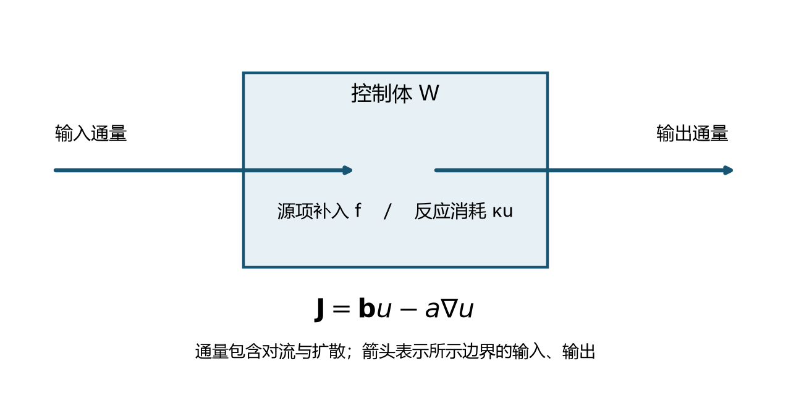
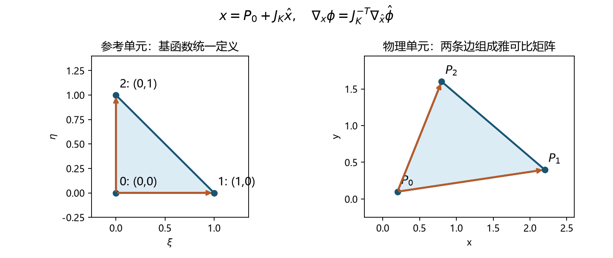
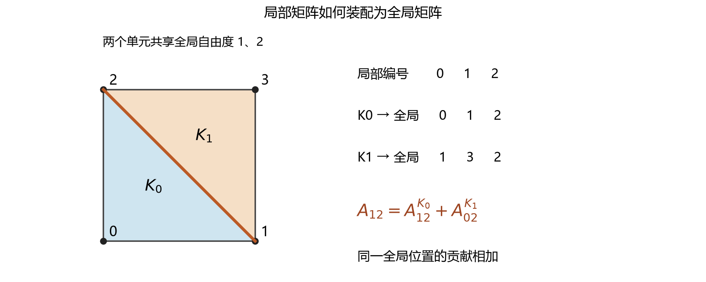
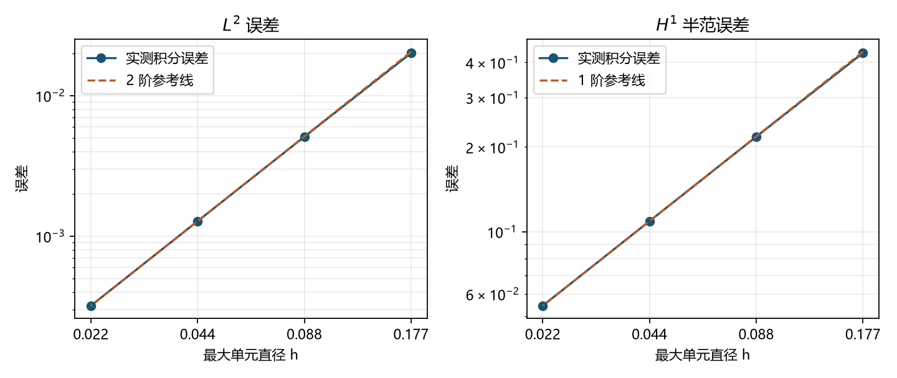

# 稳态输运问题的有限元方法

溶质随流体运动时，一方面被流动输运，另一方面向低浓度处扩散，还可能在局部发生反应。若外部条件保持不变，经过充分长的时间，浓度可能达到稳定分布。我们关心的是：怎样从这些过程写出方程，又怎样把方程变成一个可信的有限元计算？

本章以稳态反应–对流–扩散方程为对象。读者应已接触 Sobolev 空间、分部积分和有限元基本概念；下面将这些知识连接成完整的求解过程。几何与程序采用二维三角形连续一次元，模型和弱形式则先在一般维数下表述。

## 1　从局部守恒建立模型

### 1.1　通量、源项与反应

设 $u(\boldsymbol x)$ 是单位体积的溶质浓度。取区域内任意控制体 $W$，以 $\boldsymbol n$ 表示其外法向。若单位面积、单位时间通过界面的溶质量由通量 $\boldsymbol J$ 描述，那么净流出量为

$$
\int_{\partial W}\boldsymbol J\cdot\boldsymbol n\,\mathrm ds.
$$

扩散由浓度梯度驱动，采用 Fick 定律 $\boldsymbol J_{\mathrm d}=-a\nabla u$，其中 $a>0$。已知速度场 $\boldsymbol b$ 携带溶质，产生对流通量 $\boldsymbol J_{\mathrm a}=u\boldsymbol b$。若单位体积的外部补入为 $f$，一阶反应消耗为 $\kappa u$，稳态下“净流出加反应消耗等于外部补入”：

$$
\int_{\partial W}(-a\nabla u+u\boldsymbol b)\cdot\boldsymbol n\,\mathrm ds
+\int_W\kappa u\,\mathrm dx=\int_W f\,\mathrm dx.
$$

利用散度定理，并由控制体的任意性得到守恒形式

$$
-\nabla\cdot(a\nabla u)+\nabla\cdot(\boldsymbol b u)+\kappa u=f.
\tag{1}
$$

“稳态”表示局部不再积累，并不要求通量为零。只要流入、流出和反应保持平衡，浓度就可以不随时间变化。

展开对流通量，并记 $c=\kappa+\nabla\cdot\boldsymbol b$，式（1）写成

$$
\boxed{-\nabla\cdot(a\nabla u)+\boldsymbol b\cdot\nabla u+cu=f.}
\tag{2}
$$



图1　控制体中的总通量、外部补入与反应消耗。

这就是本章采用的形式。对于散度为零的速度场，$c=\kappa$；对于一般速度场，$c$ 同时包含反应与流场压缩或膨胀的贡献。换用守恒形式时必须同步处理这一项。

方程是线性的，因为 $a,\boldsymbol b,c$ 都是给定的空间函数，不依赖未知量 $u$。扩散系数随空间变化也不会破坏线性，但不能把 $-\nabla\cdot(a\nabla u)$ 简写成 $-a\Delta u$：前者还包含 $-\nabla a\cdot\nabla u$。

### 1.2　边界条件完成问题的描述

区域内部的方程还不足以确定解，必须说明区域如何与外部交换物质。规定边界浓度，就是 Dirichlet 条件

$$
u=g\quad\text{on }\partial\Omega.
\tag{3}
$$

本章从始至终采用全 Dirichlet 边界。它使我们可以把注意力集中在离散与装配上，同时保留非零边界这一重要环节。

通量条件的角色可以从分部积分看出：若某部分边界规定 $a\nabla u\cdot\boldsymbol n=h_N$，弱形式右端会出现 $\int_{\Gamma_N}h_Nv\,\mathrm ds$。这里 $h_N$ 是扩散导数的外法向分量；若规定的是物理扩散流出量 $q_N=-a\nabla u\cdot\boldsymbol n$，右端应写成 $-\int_{\Gamma_N}q_Nv\,\mathrm ds$。总通量还包含 $u\boldsymbol b$，不能与这两个量混用。

### 1.3　贯穿本章的计算问题

后面的程序在单位正方形上求解

$$
\Omega=(0,1)^2,\qquad a=1,\quad\boldsymbol b=(1,2)^T,\quad c=1.
\tag{4}
$$

为同时检验三个算子和非零边界，选择光滑函数

$$
u_\star(x,y)=1+\sin(\pi x)\sin(\pi y),\qquad g=1.
\tag{5}
$$

将它代入式（2），得到

$$
\begin{aligned}
f(x,y)={}&(2\pi^2+1)\sin(\pi x)\sin(\pi y)+1\\
&+\pi\cos(\pi x)\sin(\pi y)
+2\pi\sin(\pi x)\cos(\pi y).
\end{aligned}
\tag{6}
$$

这是制造解：先选解，再构造源项和边界。它的用途是核对实现；实际应用中直接给定 $f,g$，无需提前知道解。程序求解时只使用这些数据，$u_\star$ 留给最后的误差比较。

## 2　弱形式与边界提升

### 2.1　为什么把微分方程改写成积分问题

连续分片一次函数在每个三角形上是平面，其梯度可以跨边跳跃。它适合属于 $H^1$ 的近似，却通常不能逐点满足含二阶导数的方程。弱形式通过分部积分将扩散项的一次导数转移给测试函数，使连续分片函数能够参与求解。

取 $v\in H_0^1(\Omega)$，将式（2）乘以 $v$ 并积分。对扩散项使用 Green 公式：

$$
\int_\Omega-\nabla\cdot(a\nabla u)v
=\int_\Omega a\nabla u\cdot\nabla v
-\int_{\partial\Omega}(a\nabla u\cdot\boldsymbol n)v.
$$

测试函数的边界迹为零，因此最后一项消失。对流项已经只有一阶导数，此处保留原样。记

$$
\begin{aligned}
\mathcal A(w,v)&=\int_\Omega a\nabla w\cdot\nabla v
+\int_\Omega(\boldsymbol b\cdot\nabla w)v
+\int_\Omega cwv,\\
L(v)&=\int_\Omega fv.
\end{aligned}
\tag{7}
$$

弱问题就是求满足边界值的 $u$，使 $\mathcal A(u,v)=L(v)$ 对所有零边界测试函数成立。这里测试的是所有允许的内部变化，而不是要求边界上也满足一条独立的平衡方程。

### 2.2　非零边界为什么改变右端

设 $V=H_0^1(\Omega)$。当 $g\ne0$ 时，解不属于 $V$。取一个边界提升 $\ell\in H^1(\Omega)$，使其迹为 $g$，写成

$$
u=\ell+w,\qquad w\in V.
$$

那么问题等价于

$$
\boxed{\mathcal A(w,v)=L(v)-\mathcal A(\ell,v),\quad\forall v\in V.}
\tag{8}
$$

边界条件已经由 $\ell$ 满足，待求的 $w$ 只负责内部修正。提升并不唯一，但由它恢复的解应相同：更换提升只是在重新划分已知部分和未知部分。

对于式（5），可以取 $\ell=1$。它的梯度为零，所以 $\mathcal A(1,v)=\int_\Omega v$，提升后的右端是 $\int_\Omega(f-1)v$。注意即使边界只是一个常数，它仍通过反应项进入内部方程。这一关系稍后会变成矩阵中的边界列移项。

## 3　为什么这个弱问题有唯一稳定的解

离散前应先知道连续问题是否确定。下面给出一组足够条件，并保留证明中与离散直接有关的部分。

**命题。** 设 $\Omega$ 是有界 Lipschitz 区域，$a,c\in L^\infty(\Omega)$，$a\ge a_0>0$，$\boldsymbol b\in W^{1,\infty}(\Omega)^d$，且

$$
c-\tfrac12\nabla\cdot\boldsymbol b\ge0\quad\text{几乎处处成立}.
\tag{9}
$$

若 $f\in L^2(\Omega)$，并且 $g$ 具有 $H^1$ 提升，则弱问题有唯一解，解连续依赖于右端和提升。

**证明。** 在 $V$ 上取范数 $\|v\|_V=\|\nabla v\|_{L^2}$。Poincaré 不等式给出 $\|v\|_{L^2}\le C_P\|v\|_V$。对 $w,v\in V$，Cauchy–Schwarz 不等式说明

$$
|\mathcal A(w,v)|\le
\bigl(\|a\|_\infty+C_P\|\boldsymbol b\|_\infty+C_P^2\|c\|_\infty\bigr)
\|w\|_V\|v\|_V.
\tag{10}
$$

所以双线性型连续，记括号中的常数为 $C_A$。再看 $\mathcal A(v,v)$。由于 $v$ 的边界迹为零，

$$
\int_\Omega(\boldsymbol b\cdot\nabla v)v
=\frac12\int_\Omega\boldsymbol b\cdot\nabla(v^2)
=-\frac12\int_\Omega(\nabla\cdot\boldsymbol b)v^2.
$$

于是

$$
\mathcal A(v,v)
=\int_\Omega a|\nabla v|^2
+\int_\Omega\left(c-\tfrac12\nabla\cdot\boldsymbol b\right)v^2
\ge a_0\|v\|_V^2.
\tag{11}
$$

这称为强制性。提升后的线性泛函
$\widetilde L(v)=L(v)-\mathcal A(\ell,v)$ 在 $V$ 上连续。Lax–Milgram 定理给出唯一 $w\in V$，且

$$
\|w\|_V\le a_0^{-1}\|\widetilde L\|_{V'}.
\tag{12}
$$

由 $u=\ell+w$ 得到结论。对两组数据的差应用同一估计，就得到连续依赖性。证毕。

这一证明没有要求 $\mathcal A$ 对称。对流使它通常不对称，却不妨碍式（11）成立。对于本章常速度算例，$\nabla\cdot\boldsymbol b=0$，有效反应系数就是 $c=1$。上述条件全部满足。

## 4　三角形上的近似如何连接成整体

### 4.1　有限元空间与离散问题

将 $\Omega$ 剖分为相容三角形网格 $\mathcal T_h$。定义

$$
S_h=\{v_h\in C^0(\overline\Omega):v_h|_K\in P_1(K),\ K\in\mathcal T_h\},
\qquad V_h=S_h\cap H_0^1(\Omega).
$$

先考虑边界提升可以在 $S_h$ 中精确表示的情形。本章的 $\ell=1$ 就满足这一点。求 $u_h\in\ell+V_h$，使

$$
\mathcal A(u_h,v_h)=L(v_h),\qquad\forall v_h\in V_h.
\tag{13}
$$

这是与连续弱问题相同的方程，只把试探与测试范围限制在有限维空间。强制性仍对 $V_h$ 成立，因此精确积分的离散问题也有唯一解。

对一般光滑但非线性的边界函数，程序通常用边界插值 $g_h$ 替代 $g$，这会额外引入边界近似误差；本章采用常边界，便于单独观察空间离散误差。

### 4.2　参考单元统一了不同形状的三角形

在参考三角形
$\widehat K=\{(\xi,\eta):\xi,\eta\ge0,\xi+\eta\le1\}$ 上，三个节点基函数是

$$
\widehat\phi_0=1-\xi-\eta,\qquad
\widehat\phi_1=\xi,\qquad\widehat\phi_2=\eta.
$$

对物理三角形 $K$，以列向量表示顶点 $P_0,P_1,P_2$，定义

$$
\boldsymbol x=F_K(\widehat{\boldsymbol x})=P_0+J_K\widehat{\boldsymbol x},
\qquad J_K=[P_1-P_0\quad P_2-P_0].
\tag{14}
$$

物理基函数由 $\phi_i^K=\widehat\phi_i\circ F_K^{-1}$ 得到。它们在对应顶点取1，在另外两个顶点取0，所以单元内的函数由三个顶点值决定。



图2　映射改变单元几何，基函数的节点取值关系保持不变。图中的边向量组成 $J_K$ 的两列。

链式法则给出 $\widehat\nabla\widehat\phi_i=J_K^T\nabla\phi_i^K$，因此

$$
\boxed{\nabla\phi_i^K=J_K^{-T}\widehat\nabla\widehat\phi_i,\qquad
\mathrm dx=|\det J_K|\,\mathrm d\widehat{\boldsymbol x}.}
\tag{15}
$$

梯度使用逆转置，积分使用行列式绝对值，两者承担不同作用。例如扩散单元积分变为

$$
D^K_{ij}=\int_{\widehat K}a(F_K(\widehat{\boldsymbol x}))
(J_K^{-T}\widehat\nabla\widehat\phi_j)\cdot
(J_K^{-T}\widehat\nabla\widehat\phi_i)
|\det J_K|\,\mathrm d\widehat{\boldsymbol x}.
\tag{16}
$$

这就是在不同形状的三角形上复用同一套参考基函数和求积规则的依据。程序可以用等价的重心坐标梯度实现，并不一定显式构造每个 $J_K^{-T}$。

### 4.3　FEALPy 中的空间与坐标

完整代码见[稳态输运实验](../labs/稳态输运实验.py)；正文片段沿用其中的导入与数据函数。

```python
mesh = TriangleMesh.from_box([0, 1, 0, 1], nx=n, ny=n)
space = LagrangeFESpace(mesh, p=1)
cell_to_dof = space.cell_to_dof()
```

`mesh` 保存顶点、单元及几何量；`space` 确定近似空间，提供基函数、梯度与自由度映射。对于当前 $P_1$ 三角形，`cell_to_dof` 每行有三个全局编号，对应式（20）的 $m_K$。提高到 $P_2$ 时每行有六个编号，边中点也成为自由度；不能再把自由度编号一概当作网格顶点编号。

FEALPy 的三角形求积点常用重心坐标 $(\lambda_0,\lambda_1,\lambda_2)$，三个分量之和为1，与前面的参考坐标关系为 $(1-\xi-\eta,\xi,\eta)$。`mesh.bc_to_point(bcs)` 将它们转为物理坐标；系数函数上的 `@cartesian` 表示接收物理坐标。

### 4.4　单元矩阵的行与列

固定一个单元，以 $i$ 表示局部测试基函数编号，以 $j$ 表示局部试探基函数编号：

$$
\begin{aligned}
D^K_{ij}&=\int_Ka\nabla\phi_j^K\cdot\nabla\phi_i^K,&
C^K_{ij}&=\int_K(\boldsymbol b\cdot\nabla\phi_j^K)\phi_i^K,\\
R^K_{ij}&=\int_Kc\phi_j^K\phi_i^K,&
F^K_i&=\int_Kf\phi_i^K.
\end{aligned}
\tag{17}
$$

记 $A^K=D^K+C^K+R^K$。$P_1$ 基函数梯度为常向量。若系数在单元上为常数，利用
$\int_K\phi_i^K=|K|/3$ 及
$\int_K\phi_i^K\phi_j^K=|K|(1+\delta_{ij})/12$，可得

$$
D^K_{ij}=a|K|\nabla\phi_j^K\cdot\nabla\phi_i^K,
\quad C^K_{ij}=\frac{|K|}{3}\boldsymbol b\cdot\nabla\phi_j^K,
\quad R^K_{ij}=\frac{c|K|}{12}(1+\delta_{ij}).
\tag{18}
$$

这些公式揭示了矩阵结构：扩散与反应对称，对流的导数只在试探侧，通常不对称。系数或源项更复杂时，按式（17）数值积分即可，无需重新设计装配过程。

### 4.5　积分器实现单元双线性型

```python
@cartesian
def velocity(points):
    return np.broadcast_to(np.array([1., 2.]), points.shape)

form = BilinearForm(space)
form.add_integrator(ScalarDiffusionIntegrator(coef=1., q=5))
form.add_integrator(ScalarConvectionIntegrator(coef=velocity, q=5))
form.add_integrator(ScalarMassIntegrator(coef=1., q=5))
A = form.assembly()

load = LinearForm(space)
load.add_integrator(ScalarSourceIntegrator(source=source, q=5))
F = load.assembly()
```

四个积分器依次计算式（17）的扩散、对流、反应和源项。`ScalarMassIntegrator` 计算基函数乘积，它在此表达反应项，不含时间导数。

以对流为例，积分器取得 `basis`、`grad_basis` 和速度，在求积点计算 $\boldsymbol b\cdot\nabla\phi_j^K$，再乘测试函数 $\phi_i^K$。局部矩阵数组的两个末轴依次是测试侧、试探侧，交换它们会转置对流矩阵，也就改变离散问题。

当前三角形规则使用归一化权重 $\sum_qw_q=1$，单元积分近似为

$$
\int_K\psi\,\mathrm dx\approx |K|\sum_qw_q\psi(\boldsymbol x_q).
\tag{19}
$$

面积已经在外面相乘，不再额外乘参考三角形面积 $1/2$。`q=5` 选择求积规则，`p=1` 选择近似空间；二者作用不同。式（4）的三个双线性项为低阶多项式，求积能精确处理；正弦源项和误差积分则由高精度求积近似。

### 4.6　局部编号怎样映射到全局编号

全局基函数 $\Phi_I$ 在全局顶点 $I$ 取1，在其余顶点取0；在包含该顶点的每个单元上，它限制为一个局部基函数。相邻三角形在公共边上使用同一对端点值，其线性迹相同，所以拼出的函数连续。

设 $m_K(i)$ 把单元 $K$ 的局部编号 $i$ 映射为全局编号。展开
$u_h=\sum_JU_J\Phi_J$，取内部基函数 $\Phi_I$ 测试，得到矩阵的内部行。装配程序通常先计算所有行列，再处理边界：

$$
A_{IJ}=\sum_{K}\sum_{i,j:,m_K(i)=I,\,m_K(j)=J}A^K_{ij},
\qquad
F_I=\sum_K\sum_{i:,m_K(i)=I}F^K_i.
\tag{20}
$$



图3　相邻单元在共享自由度上累加贡献。图示只解释编号与装配；实际求解采用后文更细的网格。

例如两个单元局部到全局编号分别为 $(0,1,2)$ 与 $(1,3,2)$，那么
$A_{11}=A^{K_0}_{11}+A^{K_1}_{00}$：同一个全局顶点在两个单元中拥有不同的局部编号。这里相加的是条目，不是把两个单元矩阵排成块对角矩阵。

另一种紧凑写法是用抽取矩阵 $P_K$ 将全局系数取成单元系数 $U^K=P_KU$，于是
$A=\sum_KP_K^TA^KP_K$。左右两个映射分别处理测试侧和试探侧。实际代码不必存储 $P_K$，保存整数编号表即可。

### 4.7　装配器实现全局累加

对 $N_C$ 个三角形，单元矩阵通常存为形状 `(NC, 3, 3)` 的数组 `local`。下面用 SciPy 表达 `BilinearForm` 中同样的累加思想：

```python
rows = np.broadcast_to(cell_to_dof[:, :, None], local.shape)
cols = np.broadcast_to(cell_to_dof[:, None, :], local.shape)
A_manual = coo_matrix(
    (local.ravel(), (rows.ravel(), cols.ravel())),
    shape=(space.number_of_global_dofs(),) * 2,
).tocsr()
```

COO 格式记录每一份“行号、列号、数值”贡献，转成 CSR 时，同一全局位置的重复贡献相加。FEALPy 内部使用自身稀疏张量完成这个过程，返回的并非 SciPy 对象；此处 SciPy 片段用于解释和对照，不是额外的生产装配步骤。

这也解释了稀疏性：两个顶点只有共同属于某些单元，其基函数支集才可能重叠，矩阵条目才可能非零。局部作用通过共享自由度形成整体系统。

## 5　边界消元与线性求解

令 $I,D$ 分别为内部和边界自由度集合，$U_D=g_D$。由内部行得到

$$
A_{II}U_I+A_{ID}g_D=F_I,
\qquad A_{II}U_I=F_I-A_{ID}g_D.
\tag{21}
$$

这就是式（8）的离散版本：将已知边界贡献移到右端。可选取边界节点取值为 $g_D$、内部节点取零的离散提升；它与本章用于理论分析的常数提升不同，但最终得到相同的离散解。

```python
Ab, Fb = DirichletBC(space, gd=exact).apply(A, F)
uh = space.function()
uh[:] = spsolve(Ab, Fb, solver="scipy")
```

完整程序中的 `exact` 在这里仅提供边界值。本机实现先从右端减去已知边界向量的矩阵作用，再将边界行列置为相应单位约束，保留完整系数布局。求出的 `uh[:]` 是全局系数；`uh` 同时关联空间，可在积分点计算函数和梯度。

含对流的矩阵一般不对称，本章采用稀疏直接法。若换成迭代法，需根据矩阵性质选择算法，不能仅因扩散部分对称就把整个系统当作对称正定系统。

## 6　收敛阶的理论来源

### 6.1　Galerkin 正交性与最佳近似

暂按精确积分理解式（13），并采用可精确表示的边界提升。令 $e=u-u_h\in V$，连续与离散方程相减得

$$
\mathcal A(e,v_h)=0,\qquad\forall v_h\in V_h.
\tag{22}
$$

这是 Galerkin 正交性，指双线性型意义下的正交，不要求 $\mathcal A$ 是内积。对任意具有同一边界值的 $z_h\in\ell+V_h$，有 $z_h-u_h\in V_h$，因而

$$
\begin{aligned}
a_0\|e\|_V^2
&\le\mathcal A(e,e)\\
&=\mathcal A(e,u-z_h)+\mathcal A(e,z_h-u_h)\\
&=\mathcal A(e,u-z_h)
\le C_A\|e\|_V\|u-z_h\|_V.
\end{aligned}
$$

约去 $\|e\|_V$，得到 Céa 估计

$$
\|u-u_h\|_V\le\frac{C_A}{a_0}
\inf_{z_h\in\ell+V_h}\|u-z_h\|_V.
\tag{23}
$$

有限元误差受空间中最佳近似误差控制。对于形状正则的三角形网格、足够光滑的解和满足同一边界的 $P_1$ 插值，

$$
\|\nabla(u-u_h)\|_{L^2}\le Ch|u|_{H^2}.
\tag{24}
$$

因此期望梯度误差一阶收敛。常数依赖系数与区域；扩散很小时，$C_A/a_0$ 可能很大，式（23）并不提供对强对流统一良好的误差常数。

### 6.2　为什么 $L^2$ 误差通常多一阶

为估计 $\|e\|_{L^2}$，考虑伴随弱问题：求 $z\in V$，使

$$
\mathcal A(v,z)=(e,v)_{L^2},\qquad\forall v\in V.
\tag{25}
$$

注意未知量 $z$ 位于双线性型的第二个位置。对流使问题不对称，不能把它随意换成 $\mathcal A(z,v)$。若伴随问题满足 $H^2$ 正则性估计
$\|z\|_{H^2}\le C\|e\|_{L^2}$，则由式（22）及插值估计，

$$
\begin{aligned}
\|e\|_{L^2}^2
&=\mathcal A(e,z)
=\mathcal A(e,z-I_hz)\\
&\le Ch\|e\|_V\|z\|_{H^2}
\le Ch\|e\|_V\|e\|_{L^2}.
\end{aligned}
$$

结合式（24）得到

$$
\|u-u_h\|_{L^2}\le Ch^2|u|_{H^2}.
\tag{26}
$$

多出来的一阶来自伴随解的正则性与插值误差。本章单位正方形为凸多边形，常系数均匀椭圆伴随算子的齐次 Dirichlet 问题满足所需的 $H^2$ 正则性估计（这里使用凸多边形上的椭圆正则性结论，不展开其证明），原解也足够光滑，因此适合观察这一规律；只有 Lipschitz 区域和适定性本身，还不能推出式（26）。

实际程序包含数值求积。若求积误差不可忽略，式（22）会出现一致性误差项，需用相应误差估计处理。本章的双线性型求积精确，源项和误差采用足够高的求积规则，以便观察空间逼近的主导误差。

## 7　用实际计算检验推导与实现

### 7.1　先检验装配，再观察误差

完整程序做两类不同的检查。几何与装配检查将式（15）的梯度、式（18）的局部对流矩阵与 FEALPy 比较，再按式（20）手动累加，与 `form.assembly()` 对照。这样可以发现梯度变换、对流行列或共享自由度累加中的错误。

求解检查则使用式（5）的制造解。边界误差检查规定的边界是否满足；内部残差

$$
r_I=\frac{\|(AU-F)_I\|_2}{\max(1,\|F_I\|_2)}
\tag{27}
$$

检查内部代数方程是否解好。这里使用施加边界前的 $A,F$，只选内部行；原矩阵的边界行不是本问题要求满足的方程。

有限元误差在整个单元上积分：

$$
E_0=\left(\sum_K\int_K|u_\star-u_h|^2\right)^{1/2},
\qquad
E_1=\left(\sum_K\int_K|\nabla u_\star-\nabla u_h|^2\right)^{1/2}.
\tag{28}
$$

节点误差不能代替式（28）：两函数即使在节点处很接近，单元内部仍可能不同。程序在求积点调用 `uh.value(bcs)` 和 `uh.grad_value(bcs)`，与精确值及精确梯度比较，再按式（19）求和。

### 7.2　逐级加密与观测阶

单位正方形每个方向分成 $n$ 段，每小方格剖成两个三角形；共 $2n^2$ 个单元，$(n+1)^2$ 个 $P_1$ 自由度。以 $h=\sqrt2/n$ 表示三角形最大直径，每次将 $n$ 翻倍，$h$ 减半。观测阶为

$$
p_{\mathrm{obs}}=\frac{\log(E(h)/E(h/2))}{\log2}.
\tag{29}
$$

本次计算结果如下，完整精度见[数值结果](../labs/results/收敛结果.csv)。

| n | 自由度 | L²误差 | 观测阶 | H¹半范数误差 | 观测阶 |
|---|---:|---:|---:|---:|---:|
| 8 | 81 | 2.00831e-2 | — | 4.31958e-1 | — |
| 16 | 289 | 5.09669e-3 | 1.978 | 2.17558e-1 | 0.989 |
| 32 | 1089 | 1.27905e-3 | 1.994 | 1.08978e-1 | 0.997 |
| 64 | 4225 | 3.20070e-4 | 1.999 | 5.45140e-2 | 0.999 |

四档网格的边界误差均为0，内部归一化残差最大为6.58e-14。局部对流公式与积分器的最大差为1.67e-16，手动COO累加与装配器的最大差为1.39e-17。程序固定模型、边界、空间次数与求解方法，只改变网格尺度。



图4　制造解的积分误差与理论斜率比较。左图检验 $L^2$ 二阶，右图检验梯度一阶；参照线表示斜率，不是误差上界。

若代数残差已经很小，而加密后的误差没有按预期下降，应回到模型数据、积分、边界和正则性检查。单纯收紧线性求解容差，不能修复错误装配或提高空间逼近阶。

### 7.3　运行与进一步理解

在安装了本章所用 FEALPy 接口、NumPy、SciPy 与 Matplotlib 的环境中，从本目录运行：

```text
python labs/稳态输运实验.py
```

程序输出精简误差数据与本章插图。实际环境和本次结果记录在[阅读与运行说明](../README.md)，不需要下载完整解数组。

可以沿着同一个模型继续思考：

1. 若速度场不再散度为零，守恒形式中的反应系数与式（2）的 $c$ 如何对应？适定性证明中的有效反应项又是什么？
2. 将 Dirichlet 数据改为一个非线性函数时，连续提升、边界插值和右端移项分别发生什么变化？
3. 若两侧基函数交换，扩散矩阵不变而对流矩阵转置，哪一段代码和哪一种局部验证能发现这个问题？

## 范围与延伸

本章完整实现的是二维、标量、全 Dirichlet 边界、常系数的连续 $P_1$ Galerkin 方法。一般维数的弱形式和装配思想仍然成立，但高阶元、混合边界及变系数计算需要相应数据和实现。强对流下的稳定化不在本章展开：连续问题有唯一解、代数系统能求解，并不能保证粗网格解没有非物理振荡。

## 实现来源

本章程序接口与本机 FEALPy 源码相核对，主要涉及 `LagrangeFESpace`、`ScalarDiffusionIntegrator`、`ScalarConvectionIntegrator`、`ScalarMassIntegrator`、`BilinearForm` 和 `DirichletBC`。原有三门课程与研究程序保留在各自目录，本章的独立程序用于复现本章模型与验证。
