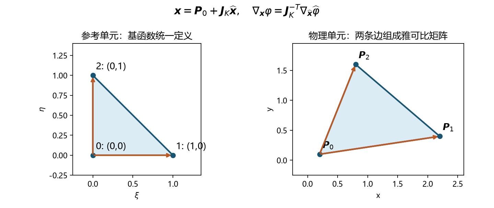
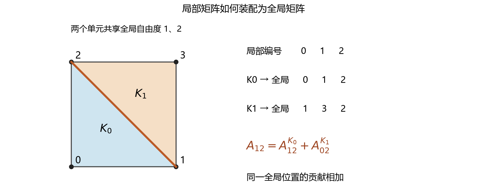

# 三角形有限元与全局装配

弱问题的解仍然是一个函数，测试也允许在无限多个方向上进行。实际计算需要选择一个有限维空间，使一个函数可以由有限个系数表示。连续分片一次元采用的办法很直接：在每个三角形上取一个线性函数，并要求相邻单元在公共边上连续。

这种近似同时涉及两种联系。几何映射把统一的参考基函数带到形状各异的物理单元；自由度映射把各单元中的系数关联到同一组全局未知量。二者配合，单元积分才能成为整体方程。下面沿用[稳态输运模型与弱问题](01-稳态输运模型与弱问题.md)中的双线性型、边界数据和制造解，穿插说明FEALPy如何完成这些运算。

## 三角形上的近似如何连接成整体

### 有限元空间与离散问题

将 $\Omega$ 剖分为相容三角形网格 $\mathcal T_h$，相邻单元只在完整公共边或顶点相交。误差分析中进一步假设网格族形状正则，即单元直径与内切圆半径的比值有与加密层级无关的上界。定义

$$
S_h=\{v_h\in C^0(\overline\Omega):v_h|_K\in \mathbb{P}_1(K),\ K\in\mathcal T_h\},
\qquad V_h=S_h\cap H_0^1(\Omega).
$$

先考虑边界提升可以在 $S_h$ 中精确表示的情形。本课的 $\ell=1$ 就满足这一点。求 $u_h\in\ell+V_h$，使

$$
\mathcal{A}(u_h,v_h)=L(v_h),\qquad\forall v_h\in V_h.
\tag{13}
$$

离散化保留了双线性型及右端，只将允许的函数限制到有限维空间。由于 $V_h\subset H_0^1(\Omega)$，第一专题证明的强制性仍然成立；精确积分下的有限维问题因此有唯一解。

对不能由 $S_h$ 精确表示的一般光滑边界函数，程序通常用边界插值 $g_h$ 替代 $g$，这会额外引入边界近似误差；本课采用常边界，便于单独观察空间离散误差。

### 参考单元统一了不同形状的三角形

在参考三角形
$\widehat K=\{(\xi,\eta):\xi,\eta\ge0,\xi+\eta\le1\}$ 上，三个节点基函数是

$$
\widehat\varphi_0=1-\xi-\eta,\qquad
\widehat\varphi_1=\xi,\qquad\widehat\varphi_2=\eta.
$$

对物理三角形 $K$，以列向量表示顶点 $\boldsymbol{P}_0,\boldsymbol{P}_1,\boldsymbol{P}_2$，定义

$$
\boldsymbol{x}=\boldsymbol{F}_K(\widehat{\boldsymbol{x}})=\boldsymbol{P}_0+\boldsymbol{J}_K\widehat{\boldsymbol{x}},
\qquad \boldsymbol{J}_K=[\boldsymbol{P}_1-\boldsymbol{P}_0\quad \boldsymbol{P}_2-\boldsymbol{P}_0].
\tag{14}
$$

物理基函数由 $\varphi_i^K=\widehat\varphi_i\circ \boldsymbol{F}_K^{-1}$ 得到。它们在对应顶点取1，在另外两个顶点取0，所以单元内的函数由三个顶点值决定。



图2　映射改变单元几何，基函数的节点取值关系保持不变。图中的边向量组成 $\boldsymbol{J}_K$ 的两列。

链式法则给出 $\widehat\nabla\widehat\varphi_i=\boldsymbol{J}_K^T\nabla\varphi_i^K$，因此

$$
\boxed{\nabla\varphi_i^K=\boldsymbol{J}_K^{-T}\widehat\nabla\widehat\varphi_i,\qquad
\mathrm dx=|\det \boldsymbol{J}_K|\,\mathrm d\widehat{\boldsymbol{x}}.}
\tag{15}
$$

梯度使用逆转置，积分使用行列式绝对值，两者承担不同作用。例如扩散单元积分变为

$$
D^K_{ij}=\int_{\widehat K}a(\boldsymbol{F}_K(\widehat{\boldsymbol{x}}))
(\boldsymbol{J}_K^{-T}\widehat\nabla\widehat\varphi_j)\cdot
(\boldsymbol{J}_K^{-T}\widehat\nabla\widehat\varphi_i)
|\det \boldsymbol{J}_K|\,\mathrm d\widehat{\boldsymbol{x}}.
\tag{16}
$$

式（15）和式（16）将基函数、梯度与积分统一到参考三角形上。单元形状的影响全部进入几何系数，参考基函数与求积规则则可以复用。FEALPy也可通过等价的重心坐标梯度实现这一运算，不必显式存储每个 $\boldsymbol{J}_K^{-T}$。

### 从链式法则逐分量看梯度变换

将参考坐标记为 $\widehat{\boldsymbol{x}}=(\xi,\eta)^T$，物理坐标记为 $\boldsymbol{x}=(x_1,x_2)^T$。由 $\widehat\varphi(\widehat{\boldsymbol{x}})=\varphi(\boldsymbol{F}_K(\widehat{\boldsymbol{x}}))$，对第 $\alpha$ 个参考坐标求导：

$$
\frac{\partial\widehat\varphi}{\partial\widehat{x}_\alpha}
=\sum_{r=1}^2\frac{\partial\varphi}{\partial x_r}
\frac{\partial x_r}{\partial\widehat{x}_\alpha}.
$$

$\boldsymbol{J}_K$ 的第 $r$ 行、第 $\alpha$ 列正是最后一个导数。将两式按列向量排列，便得到 $\widehat\nabla\widehat\varphi=\boldsymbol{J}_K^T\nabla\varphi$。所以，式（15）的逆转置由梯度的列向量约定和链式法则共同决定，不能根据图形方向猜测是否需要转置。

例如，取三角形 $\boldsymbol{P}_0=(0,0)^T$、$\boldsymbol{P}_1=(1,0)^T$、$\boldsymbol{P}_2=(1,1)^T$，则

$$
\boldsymbol{J}_K=\begin{pmatrix}1&1\\0&1\end{pmatrix},\qquad
\boldsymbol{J}_K^{-T}=\begin{pmatrix}1&0\\-1&1\end{pmatrix}.
$$

若顶点值为 $(0,1,3)$，参考函数为 $\widehat u_h=\xi+3\eta$。它的参考梯度为 $(1,3)^T$，物理梯度却是 $\boldsymbol{J}_K^{-T}(1,3)^T=(1,2)^T$，对应物理函数 $u_h=x_1+2x_2$。三个顶点值与该函数逐一相符；若漏掉转置，得到的梯度就不能满足这一关系。这个单元足以同时检验映射、梯度和局部系数，不必为不同形状各设一套求解实验。

面积变换则来自平行四边形面积的缩放：参考三角形面积为 $1/2$，两条边经 $\boldsymbol{J}_K$ 映射后，物理面积为 $|K|=|\det \boldsymbol{J}_K|/2$。若采用和为1的归一化求积权重，面积已通过 $|K|$ 纳入；若采用参考积分权重，权重和为 $1/2$，则应乘 $|\det \boldsymbol{J}_K|$。两种约定表达同一积分，不能混用其中的一半。

### 次数、维数与几何的分工

在 $d$ 维单纯形上，总次数不超过 $p$ 的多项式空间具有

$$
\dim \mathbb{P}_p(K)=\binom{p+d}{d}
$$

个局部自由度。三角形上的 $\mathbb{P}_1$ 有3个、$\mathbb{P}_2$ 有6个，四面体上的 $\mathbb{P}_1$ 有4个。提高次数增加的是单元内可以表示的多项式，而加密网格改变的是单元的大小与数量。对于相容Lagrange元，公共顶点、边或面上的自由度由相邻单元共享，故全局自由度数不能用单元数直接乘局部自由度数。

二维 $\mathbb{P}_2$ 的六个自由度位于三个顶点和三条边的中点。记参考或物理三角形上的重心坐标为 $\lambda_0,\lambda_1,\lambda_2$，满足 $\sum_i\lambda_i=1$，在对应顶点取1、其余顶点取0。以这些坐标表示，六个基函数为

$$
\lambda_i(2\lambda_i-1),\quad i=0,1,2,
\qquad 4\lambda_0\lambda_1,\quad4\lambda_1\lambda_2,\quad4\lambda_2\lambda_0.
$$

公共边上的三个自由度确定同一条二次多项式迹，从而保证相邻单元连续。这与 $\mathbb{P}_1$ 用公共边两端值保证连续的机制相同。仿射单元的梯度变换仍是式（15），但 $\mathbb{P}_2$ 梯度随积分点变化，不再能从积分号内直接提出。

FEALPy将这些变化封装在空间和自由度对象中。`number_of_local_dofs()` 返回局部自由度数，`interpolation_points()` 返回全局插值点，`cell_to_dof()` 给出其共享编号。网格顶点、插值点和函数系数在 $\mathbb{P}_1$ 中恰好一一对应，换成高阶元后就必须分别理解。三维与高阶的这些结构说明属于理论推广；本课随附的收敛实验仍采用二维 $\mathbb{P}_1$。

### FEALPy 中的空间与坐标

下面 $n$ 为每个坐标方向的剖分段数。完整代码见[稳态输运实验](../labs/稳态输运实验.py)；正文片段沿用其中的导入与数据函数。

```python
from fealpy.backend import backend_manager as bm
from fealpy.mesh import TriangleMesh
from fealpy.functionspace import LagrangeFESpace

bm.set_backend('numpy')
n = 8
mesh = TriangleMesh.from_box([0, 1, 0, 1], nx=n, ny=n)
space = LagrangeFESpace(mesh, p=1)
cell_to_dof = space.cell_to_dof()
```

`mesh` 保存顶点、单元及几何量；`space` 确定近似空间，提供基函数、梯度与自由度映射。对于当前 $\mathbb{P}_1$ 三角形，`cell_to_dof` 每行有三个全局编号，对应式（20）的 $m_K$。提高到 $\mathbb{P}_2$ 时每行有六个编号，边中点也成为自由度；不能再把自由度编号一概当作网格顶点编号。

FEALPy 的三角形求积点常用重心坐标 $(\lambda_0,\lambda_1,\lambda_2)$，三个分量之和为1，与前面的参考坐标关系为 $(1-\xi-\eta,\xi,\eta)$。`mesh.bc_to_point(bcs)` 将它们转为物理坐标；系数函数上的 `@cartesian` 表示接收物理坐标。

### 单元矩阵的行与列

固定一个单元，以 $i$ 表示局部测试基函数编号，以 $j$ 表示局部试探基函数编号：

$$
\begin{aligned}
D^K_{ij}&=\int_Ka\nabla\varphi_j^K\cdot\nabla\varphi_i^K,&
C^K_{ij}&=\int_K(\boldsymbol{\beta}\cdot\nabla\varphi_j^K)\varphi_i^K,\\
R^K_{ij}&=\int_Kc\varphi_j^K\varphi_i^K,&
F^K_i&=\int_Kf\varphi_i^K.
\end{aligned}
\tag{17}
$$

记 $\boldsymbol{A}^K=\boldsymbol{D}^K+\boldsymbol{C}^K+\boldsymbol{R}^K$。$\mathbb{P}_1$ 基函数梯度为常向量。若系数在单元上为常数，利用
$\int_K\varphi_i^K=|K|/3$ 及
$\int_K\varphi_i^K\varphi_j^K=|K|(1+\delta_{ij})/12$，可得

$$
D^K_{ij}=a|K|\nabla\varphi_j^K\cdot\nabla\varphi_i^K,
\quad C^K_{ij}=\frac{|K|}{3}\boldsymbol{\beta}\cdot\nabla\varphi_j^K,
\quad R^K_{ij}=\frac{c|K|}{12}(1+\delta_{ij}).
\tag{18}
$$

扩散与反应积分对交换 $i,j$ 不变，因此相应矩阵对称。对流中的导数作用在试探基函数上，交换两侧会改变积分，矩阵通常不对称。这种结构由弱形式决定，与是否采用闭式积分无关。变系数情形仍按式（17）计算，只是需要在求积点处取系数值。

### 局部积分公式的来源

式（18）中的系数可以从一个参考积分推导出来。以 $\widehat\varphi_1=\xi$、$\widehat\varphi_2=\eta$ 为例，

$$
\int_{\widehat K}\xi^2\,\mathrm d\xi\mathrm d\eta
=\int_0^1\xi^2(1-\xi)\,\mathrm d\xi=\frac1{12},
$$

$$
\int_{\widehat K}\xi\eta\,\mathrm d\xi\mathrm d\eta
=\frac12\int_0^1\xi(1-\xi)^2\,\mathrm d\xi=\frac1{24}.
$$

乘以 $|\det \boldsymbol{J}_K|=2|K|$，得到物理单元上对角项 $|K|/6$ 与非对角项 $|K|/12$。参考三角形三个顶点的地位对称，因此其余基函数具有相同的对应积分。于是局部质量型矩阵为

$$
\boldsymbol{M}^K=\frac{|K|}{12}
\begin{pmatrix}2&1&1\\1&2&1\\1&1&2\end{pmatrix},\qquad \boldsymbol{R}^K=c\boldsymbol{M}^K.
$$

这里 $\boldsymbol{M}^K$ 仅表示基函数乘积的积分结构，稳态系统中实际使用的是反应矩阵 $\boldsymbol{R}^K$。同理，$\int_K\varphi_i^K=|K|/3$，而常向量 $\boldsymbol{\beta}$ 与 $\mathbb{P}_1$ 梯度都可以提出积分号外，便得到式（18）的对流条目。对流矩阵的三行相同，是这一个常系数线性单元的结果；它并不是一般高阶元或变系数矩阵都应具有的结构。

扩散积分还有一个有用的结构检验。由 $\sum_j\varphi_j^K=1$，得 $\sum_j\nabla\varphi_j^K=0$，所以 $\sum_jD^K_{ij}=0$。常函数在单元内部不产生扩散贡献。未经Dirichlet处理的纯扩散全矩阵也有常数零空间；因此，局部扩散矩阵行和为零与施加全Dirichlet条件后的内部矩阵可逆并不矛盾。

### 积分器实现单元双线性型

下面的代码从同一组制造解数据开始。将本节两个代码块依次放入同一个 Python 文件，即可得到未施加边界的 `A,F`；接下来的边界与求解步骤见[完整求解流程](04-FEALPy求解流程.md)。其中导入、网格、空间和源项均在这里定义。

```python
import numpy as np
from fealpy.backend import backend_manager as bm
from fealpy.decorator import cartesian
from fealpy.mesh import TriangleMesh
from fealpy.functionspace import LagrangeFESpace
from fealpy.fem import (BilinearForm, LinearForm,
    ScalarDiffusionIntegrator, ScalarConvectionIntegrator,
    ScalarMassIntegrator, ScalarSourceIntegrator)

bm.set_backend('numpy')
mesh = TriangleMesh.from_box([0, 1, 0, 1], nx=8, ny=8)
space = LagrangeFESpace(mesh, p=1)

@cartesian
def exact(points):
    x, y = points[..., 0], points[..., 1]
    return 1. + np.sin(np.pi*x)*np.sin(np.pi*y)

@cartesian
def source(points):
    x, y = points[..., 0], points[..., 1]
    s = np.sin(np.pi*x)*np.sin(np.pi*y)
    ux = np.pi*np.cos(np.pi*x)*np.sin(np.pi*y)
    uy = np.pi*np.sin(np.pi*x)*np.cos(np.pi*y)
    return 2*np.pi**2*s + ux + 2*uy + exact(points)
```

```python
@cartesian
def velocity(points):
    return np.broadcast_to(np.array([1., 2.]), points.shape)

form = BilinearForm(space)
form.add_integrator(ScalarDiffusionIntegrator(coef=1., q=3))
form.add_integrator(ScalarConvectionIntegrator(coef=velocity, q=3))
form.add_integrator(ScalarMassIntegrator(coef=1., q=3))
A = form.assembly()

load = LinearForm(space)
load.add_integrator(ScalarSourceIntegrator(source=source, q=3))
F = load.assembly()
```

代码中的 `A,F` 分别对应 $\boldsymbol{A},\boldsymbol{F}$；`velocity` 对应给定速度场 $\boldsymbol{\beta}$。四个积分器依次计算式（17）的扩散、对流、反应和源项。`ScalarMassIntegrator` 计算基函数乘积，它在此表达反应项，不含时间导数。

以对流为例，积分器取得 `basis`、`grad_basis` 和速度，在求积点计算 $\boldsymbol{\beta}\cdot\nabla\varphi_j^K$，再乘测试函数 $\varphi_i^K$。局部矩阵数组的两个末轴依次是测试侧、试探侧，交换它们会转置对流矩阵，也就改变离散问题。

当前三角形规则使用归一化权重 $\sum_qw_q=1$，单元积分近似为

$$
\int_K\psi\,\mathrm dx\approx |K|\sum_qw_q\psi(\boldsymbol{x}_q).
\tag{19}
$$

面积已经在外面相乘，不再额外乘参考三角形面积 $1/2$。`q=3` 选择求积规则，`p=1` 选择近似空间；二者作用不同。式（4）的三个双线性项为低阶多项式，求积能精确处理；正弦源项由三阶规则近似；误差评估单独使用 `quadrature_formula(5)`，避免把评价规则与装配参数混在一起。这里的3是求积规则的参数，不是三次有限元。

### 变系数怎样进入积分

对于常系数 $\mathbb{P}_1$，式（18）可以直接给出单元矩阵。若 $a=a(\boldsymbol{x})$，梯度虽仍为常向量，系数却随积分点变化，应计算

$$
D^K_{ij}\approx |K|\sum_qw_q a(\boldsymbol{x}_q)
\nabla\varphi_j^K(\boldsymbol{x}_q)\cdot\nabla\varphi_i^K(\boldsymbol{x}_q).
$$

弱式中只需要 $a$ 的取值，不需要额外把 $\nabla a\cdot\nabla u_h$ 加入扩散积分；那会把强形式展开项重复计入。相应的数据回调可以写为

```python
@cartesian
def diffusion(points):
    return 1.0 + points[..., 0]

# 重新建立双线性型，替换扩散系数；其余项仍按模型加入
variable_form = BilinearForm(space)
variable_form.add_integrator(ScalarDiffusionIntegrator(coef=diffusion, q=3))
variable_form.add_integrator(ScalarConvectionIntegrator(coef=velocity, q=3))
variable_form.add_integrator(ScalarMassIntegrator(coef=1., q=3))
```

这个片段说明系数接口，不能直接叠加到已有扩散项之上。本课的常系数实验若改用它，问题本身也已改变；继续使用同一制造解时，源项必须按新的 $-\nabla\cdot(a\nabla u_\star)$ 重新计算。

对物理积分点数组 `points`，常见形状为 `(NC, NQ, d)`。标量扩散、反应与源项返回 `(NC, NQ)`，速度和解梯度返回 `(NC, NQ, d)`。装饰器 `@cartesian` 只说明坐标约定，不替回调求导。本机扩散积分器先取求积点和单元测度，再经 `process_coef_func` 求系数值，最后将它们与物理基函数梯度交给 `bilinear_integral`。这一分工可以直接同上式对照。

常系数仿射 $\mathbb{P}_p$ 元的扩散、对流和反应被积函数次数分别不超过 $2p-2$、$2p-1$、$2p$；多项式系数的次数还需相加。因而提高空间次数时，求积规则也必须足以覆盖新的被积函数。非多项式系数没有一个有限次数规则能普遍保证精确积分，可在固定空间上提高求积精度，判断数值积分误差是否已经小于所研究的离散误差。这里说的是规则的多项式精度；FEALPy参数 `q` 的具体编号应按相应单元的规则实现核对，不能将它直接理解为积分点个数。

### 局部编号怎样映射到全局编号

全局基函数 $\varphi_I$ 在全局顶点 $I$ 取1，在其余顶点取0；在包含该顶点的每个单元上，它限制为一个局部基函数。相邻三角形在公共边上使用同一对端点值，其线性迹相同，所以拼出的函数连续。

设 $m_K(i)$ 把单元 $K$ 的局部编号 $i$ 映射为全局编号。展开
$u_h=\sum_JU_J\varphi_J$，其中 $\boldsymbol{U}=(U_0,\ldots,U_{N-1})^T$ 是全局系数向量，$N$ 为全局自由度数。取内部基函数 $\varphi_I$ 测试，得到矩阵的内部行。装配程序通常先计算所有行列，再处理边界：

$$
A_{IJ}=\sum_{K}\sum_{\substack{i,j\\m_K(i)=I,\,m_K(j)=J}}A^K_{ij},
\qquad
F_I=\sum_K\sum_{i:\,m_K(i)=I}F^K_i.
\tag{20}
$$



图3　相邻单元在共享自由度上累加贡献。图示只解释编号与装配；实际求解采用后文更细的网格。

例如两个单元局部到全局编号分别为 $(0,1,2)$ 与 $(1,3,2)$，那么
$A_{11}=A^{K_0}_{11}+A^{K_1}_{00}$：同一个全局顶点在两个单元中拥有不同的局部编号。这里相加的是条目，不是把两个单元矩阵排成块对角矩阵。

另一种紧凑写法是用抽取矩阵 $\boldsymbol{P}_K$ 将全局系数取成单元系数 $\boldsymbol{U}^K=\boldsymbol{P}_K\boldsymbol{U}$，于是
$\boldsymbol{A}=\sum_K\boldsymbol{P}_K^T\boldsymbol{A}^K\boldsymbol{P}_K$。左右两个映射分别处理测试侧和试探侧。实际代码不必存储 $\boldsymbol{P}_K$，保存整数编号表即可。

### 四个编号分别控制什么

局部编号 $i,j$ 与全局编号 $I,J$ 不处在同一层。固定全局测试函数 $\varphi_I$，它只在包含顶点 $I$ 的单元上非零。在某个这样的单元 $K$ 中，若 $m_K(i)=I$，则 $\varphi_I|_K=\varphi_i^K$。同样，只有满足 $m_K(j)=J$ 的单元限制才会参与第 $J$ 列。将全局积分拆成单元积分便严格得到式（20）。

对图3中的两个单元，抽取矩阵可以明确写为

$$
\boldsymbol{P}_{K_0}=\begin{pmatrix}1&0&0&0\\0&1&0&0\\0&0&1&0\end{pmatrix},
\qquad
\boldsymbol{P}_{K_1}=\begin{pmatrix}0&1&0&0\\0&0&0&1\\0&0&1&0\end{pmatrix}.
$$

每一行恰好选择一个全局系数。例如 $\boldsymbol{P}_{K_1}\boldsymbol{U}=(U_1,U_3,U_2)^T$。左乘 $\boldsymbol{P}_K^T$ 把一份局部测试贡献送回全局行，右乘 $\boldsymbol{P}_K$ 把全局试探系数送到单元列，因此两者不能颠倒。全局条目 $A_{12}$ 接收 $K_0$ 的局部 $(1,2)$ 项与 $K_1$ 的局部 $(0,2)$ 项。

装配中的这些编号只负责同一有限元函数的几何拼接。边界约束尚未进入；在下一节取出内部行、移去已知边界列以后，才得到真正要求解的自由系数系统。由此可以分别核对几何映射、共享编号和边界处理，避免把不同层面的错误归到一次线性求解中。

### 装配器实现全局累加

对 $N_C$ 个三角形，单元矩阵通常存为形状 `(NC, 3, 3)` 的数组 `local`。下面用 SciPy 表达 `BilinearForm` 中同样的累加思想：

```python
rows = np.broadcast_to(cell_to_dof[:, :, None], local.shape)
cols = np.broadcast_to(cell_to_dof[:, None, :], local.shape)
A_manual = coo_matrix(
    (local.ravel(), (rows.ravel(), cols.ravel())),
    shape=(space.number_of_global_dofs(),) * 2,
).tocsr()
```

COO 格式记录每一份“行号、列号、数值”贡献，转成 CSR 时，同一全局位置的重复贡献相加。FEALPy 内部使用自身稀疏张量完成这个过程，返回的并非 SciPy 对象；此处 SciPy 片段用于解释和对照，不是额外的生产装配步骤。

矩阵的稀疏性也来自这种局部支集：若两个顶点不属于任何共同单元，其基函数的乘积和梯度乘积几乎处处为零，便不会产生相应的矩阵贡献。

## 边界消元与线性求解

令 $\mathcal I,\mathcal{D}$ 分别为内部和边界自由度集合，$\boldsymbol{U}_{\mathcal D}=\boldsymbol{g}_{\mathcal D}$。其中 $\boldsymbol{g}_{\mathcal D}$ 收集边界节点上的已知值。由内部行得到

$$
\boldsymbol{A}_{\mathcal I\mathcal I}\boldsymbol{U}_{\mathcal I}+\boldsymbol{A}_{\mathcal I\mathcal D}\boldsymbol{g}_{\mathcal D}=\boldsymbol{F}_{\mathcal I},
\qquad \boldsymbol{A}_{\mathcal I\mathcal I}\boldsymbol{U}_{\mathcal I}=\boldsymbol{F}_{\mathcal I}-\boldsymbol{A}_{\mathcal I\mathcal D}\boldsymbol{g}_{\mathcal D}.
\tag{21}
$$

边界列乘以已知系数后移到右端，与第一专题式（8）的边界提升是同一运算。可选取边界节点取值为 $\boldsymbol{g}_{\mathcal D}$、内部节点取零的离散提升；它与本课用于理论分析的常数提升不同，但最终得到相同的离散解：两个离散提升之差属于 $V_h$，相应解的差也属于 $V_h$。离散方程相减后取解差作测试函数，由强制性知解差为零。

```python
Ab, Fb = DirichletBC(space, gd=exact).apply(A, F)
uh = space.function()
uh[:] = spsolve(Ab, Fb, solver="scipy")
```

完整程序中的 `exact` 在这里仅提供边界值。本机实现先从右端减去已知边界向量的矩阵作用，再将边界行列置为相应单位约束，保留完整系数布局。求出的 `uh[:]` 是全局系数；`uh` 同时关联空间，可在积分点计算函数和梯度。

含对流的矩阵一般不对称，本课采用稀疏直接法。若换成迭代法，需根据矩阵性质选择算法，不能仅因扩散部分对称就把整个系统当作对称正定系统。


### 从矩阵求解到实际问题的数据

施加边界后求解的是 $\boldsymbol{A}_b\boldsymbol{U}=\boldsymbol{F}_b$，对应代码中的 `Ab,Fb`。在可逆条件下可形式地写为 $\boldsymbol{U}=\boldsymbol{A}_b^{-1}\boldsymbol{F}_b$，程序却不需要形成整个逆矩阵。一般CDR矩阵不对称，稀疏直接法通常通过置换、LU分解与回代求解；分解产生的填充使耗时和存储不仅取决于原矩阵的非零元数。大规模问题可能采用GMRES等迭代法和预条件技术，CG则还要求对称正定性。这些算法的系统讨论属于SOL-301，本课使用直接法以便将注意力放在离散误差上。

制造解只是核对程序的一种输入方式。实际问题所需的是区域、$a,\boldsymbol{\beta},c$、$f$ 和 $g$，并不需要给出内部真解。若没有解析解，`DirichletBC` 的 `gd` 应接收独立的边界函数，`ScalarSourceIntegrator` 接收实际源项；事后改用网格比较或可信参考结果评估误差。本课程序把 `exact` 同时用于边界与误差比较，是为了复现这一制造解，不能将它理解为有限元算法本身要求已知答案。

原CDR项目中的 `CDRModel`、`SymbolicCDR` 和 `CDRSolver` 分别组织模型数据、符号制造解与求解流程，FEALPy则提供网格、空间、积分器、边界与稀疏求解部件。原项目还用末轴保存物质分量，即使只有一个物质，源项也可能返回 `(NC,NQ,1)`；本课直接交给标量积分器的源项则返回 `(NC,NQ)`。复用程序时应明确数据属于哪一层，不能只按变量名称相似就替换。

离散系统确定了有限元函数，函数本身与真实解之间仍有距离。下一专题[有限元误差与收敛验证](03-有限元误差与收敛验证.md)将利用连续问题与离散问题的共同结构估计这一误差。
