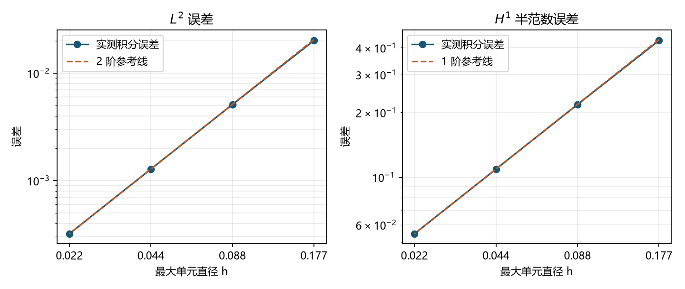

# 有限元误差与收敛验证

一个线性系统可以解得很精确，而它所表示的分片函数仍然离真实解相当远。有限元误差的根源在于近似空间受到限制；线性求解只确定这个空间中的系数，无法消除空间本身的逼近误差。

本专题从[三角形有限元与全局装配](02-三角形有限元与全局装配.md)的离散问题出发，推导误差为何随网格加密下降，再用同一制造解检验预期的收敛阶。前两专题中的算子、空间和边界提升记号继续沿用，公式编号也保持连续，便于对照。

## 收敛阶的理论来源

### Galerkin 正交性与最佳近似

暂按精确积分理解式（13），并采用可精确表示的边界提升。令 $e=u-u_h\in V$，连续与离散方程相减得

$$
\mathcal{A}(e,v_h)=0,\qquad\forall v_h\in V_h.
\tag{22}
$$

这一关系称为Galerkin正交性：误差作用于每个离散测试函数时都得到零。即使含对流的 $\mathcal{A}$ 不对称、不能作为内积使用，式（22）仍由两组方程直接相减而成立。对任意具有同一边界值的 $z_h\in\ell+V_h$，有 $z_h-u_h\in V_h$，因而

$$
\begin{aligned}
a_0\|e\|_V^2
&\le\mathcal{A}(e,e)\\
&=\mathcal{A}(e,u-z_h)+\mathcal{A}(e,z_h-u_h)\\
&=\mathcal{A}(e,u-z_h)
\le C_A\|e\|_V\|u-z_h\|_V.
\end{aligned}
$$

约去 $\|e\|_V$，得到 Céa 估计

$$
\|u-u_h\|_V\le\frac{C_A}{a_0}
\inf_{z_h\in\ell+V_h}\|u-z_h\|_V.
\tag{23}
$$

有限元误差受空间中最佳近似误差控制。对于形状正则的三角形网格、足够光滑的解和满足同一边界的 $\mathbb{P}_1$ 插值，

$$
\|\nabla(u-u_h)\|_{L^2}\le Ch|u|_{H^2}.
\tag{24}
$$

式（24）给出了梯度误差随 $h$ 一阶下降的预期。估计中的常数依赖系数与区域；扩散很小时，$C_A/a_0$ 可能很大，式（23）并不提供对强对流统一良好的误差常数。

### 插值估计如何给出误差阶

记 $I_hu$ 为连续 $\mathbb{P}_1$ 节点插值。对于本课二维情形，$H^2$ 正则性保证节点值有意义；在形状正则的三角形网格族上，有

$$
\|u-I_hu\|_{L^2(K)}\le C h_K^2|u|_{H^2(K)},\qquad
|u-I_hu|_{H^1(K)}\le C h_K|u|_{H^2(K)}.
$$

其中 $h_K$ 是单元直径，$|u|_{H^2(K)}$ 由二阶弱导数的平方积分定义，$C$ 与单元形状正则性有关。线性插值精确再现一次多项式，所以误差由局部二阶变化控制；参考单元上的估计经几何缩放产生上述 $h_K$ 因子。若三角形不断退化，逆映射可能放大梯度，统一的常数便不能保证。这说明误差估计需要网格形状条件，而非只要求最大单元直径变小。

令 $h=\max_Kh_K$，将单元 $H^1$ 半范数误差平方相加，得到

$$
|u-I_hu|_{H^1(\Omega)}^2
\le C h^2\sum_K|u|_{H^2(K)}^2.
$$

本课常数边界可被空间精确表示，故 $I_hu\in\ell+V_h$。在式（23）的下确界中选取 $z_h=I_hu$，就得到式（24）。这个选择解释了为什么Céa估计称为拟最优性：实际求出的Galerkin解，误差不超过一个有明确构造的插值近似误差的常数倍。解不够光滑或材料界面导致全局 $H^2$ 失效时，需要按实际正则性重新确定预期阶。

### 伴随问题与 $L^2$ 误差

为估计 $\|e\|_{L^2}$，考虑伴随弱问题：求 $z\in V$，使

$$
\mathcal{A}(v,z)=(e,v)_{L^2},\qquad\forall v\in V.
\tag{25}
$$

注意未知量 $z$ 位于双线性型的第二个位置。对流使问题不对称，不能把它随意换成 $\mathcal{A}(z,v)$。转置双线性型 $\mathcal{A}^*(w,v)=\mathcal{A}(v,w)$ 具有同样的连续性与强制性，故伴随弱问题也由 Lax–Milgram 定理确定唯一解。若进一步满足 $H^2$ 正则性估计
$\|z\|_{H^2}\le C\|e\|_{L^2}$，则 $z$ 的零边界节点插值 $I_hz$ 属于 $V_h$。在式（25）中取 $v=e$，再由式（22）消去 $\mathcal{A}(e,I_hz)$，结合插值估计可得

$$
\begin{aligned}
\|e\|_{L^2}^2
&=\mathcal{A}(e,z)
=\mathcal{A}(e,z-I_hz)\\
&\le Ch\|e\|_V\|z\|_{H^2}
\le Ch\|e\|_V\|e\|_{L^2}.
\end{aligned}
$$

结合式（24）得到

$$
\|u-u_h\|_{L^2}\le Ch^2|u|_{H^2}.
\tag{26}
$$

伴随问题把 $L^2$ 误差同另一个椭圆问题联系起来；伴随解的插值误差又带来一个因子 $h$，因而得到比梯度误差高一阶的估计。本课单位正方形为凸多边形，常系数均匀椭圆伴随算子的齐次 Dirichlet 问题满足所需的 $H^2$ 正则性估计（这里使用凸多边形上的椭圆正则性结论，不展开其证明），原解也足够光滑，因此适合观察这一规律；只有 Lipschitz 区域和适定性本身，还不能推出式（26）。

对于足够光滑的系数和函数，式（25）中的伴随算子还可以从分部积分认出。由于第一变量的边界迹为零，

$$
\mathcal{A}(v,z)=\int_\Omega
v\bigl[-\nabla\cdot(a\nabla z)-\nabla\cdot(\boldsymbol{\beta} z)+cz\bigr]\,\mathrm dx.
$$

因此伴随强算子是 $-\nabla\cdot(a\nabla z)-\nabla\cdot(\boldsymbol{\beta} z)+cz$；当速度无散时，对流方向变为 $-\boldsymbol{\beta}$。式（25）的参数顺序并非形式上的习惯，它决定了这里的对流符号。伴随解的 $H^2$ 正则性保证 $I_hz$ 的插值误差含有一个因子 $h$，与原问题的能量误差结合后，才形成 $L^2$ 的二阶估计。

实际程序包含数值求积。若求积误差不可忽略，式（22）会出现一致性误差项，需用相应误差估计处理。本课的双线性型求积精确，源项和误差采用足够高的求积规则，以便观察空间逼近的主导误差。

### 精确积分的理论与程序求积之间

Céa证明使用的离散方程是 $\mathcal{A}(u_h,v_h)=L(v_h)$。若程序使用求积型 $\mathcal A_h,L_h$，求出的函数应记为 $u_h^q$，满足 $\mathcal A_h(u_h^q,v_h)=L_h(v_h)$。这时令 $e^q=u-u_h^q$，对任意 $v_h\in V_h$ 有

$$
\mathcal{A}(e^q,v_h)
=(L-L_h)(v_h)+(\mathcal A_h-\mathcal{A})(u_h^q,v_h).
$$

右端是求积的一致性误差；只有它足够小，原来的Galerkin正交关系才可近似用于解释实际结果。提高空间次数而保持过低的求积精度，可能使这一误差主导最终结果。本课常系数 $\mathbb{P}_1$ 的双线性项被精确积分，正弦源项与误差范数采用较高精度规则，所以在当前网格范围内主要观察到空间误差。这里依据的是所用积分结构与已有收敛数据，未把非多项式求积宣称为精确积分。

## 代数误差与离散误差

设精确求解离散方程得到系数 $\boldsymbol{U}$，实际线性求解得到 $\widetilde{\boldsymbol{U}}$，以 $\boldsymbol{r}_b=\boldsymbol{F}_b-\boldsymbol{A}_b\widetilde{\boldsymbol{U}}$ 表示残量。这里 $\boldsymbol{A}_b,\boldsymbol{F}_b$ 明确表示施加边界后的矩阵与右端，与式（27）的原矩阵 $\boldsymbol{A},\boldsymbol{F}$ 区别。对应的可逆系统满足

$$
\boldsymbol{A}_b(\boldsymbol{U}-\widetilde{\boldsymbol{U}})=\boldsymbol{r}_b.
$$

因此，残量小到什么程度才算足够，还与矩阵的逆作用有关。在一致的矩阵范数下，若 $\boldsymbol{F}_b\ne0$，

$$
\frac{\|\boldsymbol{U}-\widetilde{\boldsymbol{U}}\|}{\|\boldsymbol{U}\|}
\le\operatorname{cond}(\boldsymbol{A}_b)\frac{\|\boldsymbol{r}_b\|}{\|\boldsymbol{F}_b\|}.
$$

这是一条代数估计；系数向量的欧氏范数与函数的 $L^2$ 范数并不相同，后者需要质量矩阵刻画。即使线性系统已经被精确求解，有限维空间仍可能无法充分逼近真解。将实际有限元函数记为 $\widetilde u_h$，总误差分解为

$$
u-\widetilde u_h=(u-u_h)+(u_h-\widetilde u_h).
$$

前一项由空间、模型数据近似和数值积分决定，后一项由代数求解决定。收敛实验应使后一项足够小，才能辨认网格加密带来的变化；反之，在粗网格上反复收紧求解容差，只会更精确地得到同一个离散解。

## 强对流下为何会出现锯齿

适定性与拟最优性不意味着任意粗网格都能给出单调、无振荡的解。用一维常系数问题可以解析地看清这个差别：

$$
-au''+bu'=0,\qquad u(0)=0,\quad u(1)=1,\qquad a,b>0.
$$

解为 $u(x)=(e^{bx/a}-1)/(e^{b/a}-1)$，始终单调；当 $a/b$ 很小时，主要变化集中在出流端附近厚度约为 $a/b$ 的区域。均匀网格连续 $\mathbb{P}_1$ Galerkin的内部方程为

$$
\left(-\frac ah-\frac b2\right)U_{i-1}
+\frac{2a}{h}U_i
+\left(-\frac ah+\frac b2\right)U_{i+1}=0.
$$

令 $\delta_i=U_i-U_{i-1}$，整理得

$$
\frac{\delta_{i+1}}{\delta_i}=\frac{1+Pe}{1-Pe},
\qquad Pe=\frac{bh}{2a}.
$$

当 $Pe>1$ 时，相邻增量异号，离散曲线便出现锯齿。它与真解的单调性不符，却可以精确满足已装配方程。这也是小代数残量不能排除空间离散失真的一个明确例子。加密网格会减小单元Péclet数，但解析很薄的边界层可能需要相当多的自由度。

SUPG采用另一种处理：在每个单元增加沿流线的残差加权项

$$
\sum_K\int_K\tau_K(\boldsymbol{\beta}\cdot\nabla v_h)\mathcal{R}(u_h),
\qquad
\mathcal{R}(u_h)=-\nabla\cdot(a\nabla u_h)+\boldsymbol{\beta}\cdot\nabla u_h+cu_h-f.
$$

精确光滑解的残差为零，因此新增项具有一致性。在上述常系数、零反应的一维 $\mathbb{P}_1$ 情形中，单元内部 $u_h''=0$，该项相当于沿流线增加 $\tau b^2$ 的扩散。推广到变系数、高阶元或非零反应时，必须保留相应扩散残差、反应和源项修正，不能仅加一个对流矩阵就称为完整SUPG。原CDR项目计算自定义局部修正后通过 `ConstIntegrator` 接入FEALPy装配；本课随附程序仍是标准Galerkin，未新增稳定化实验。稳定化控制离散振荡，解析薄层仍取决于空间分辨率。

## 用实际计算检验推导与实现

### 先检验装配，再观察误差

收敛实验依赖一个前提：程序确实实现了所写的离散方程。几何与装配检查将式（15）的梯度、式（18）的局部对流矩阵与 FEALPy 比较，再按式（20）手动累加，与 `form.assembly()` 对照。这样可以发现梯度变换、对流行列或共享自由度累加中的错误。

完成装配以后，使用第一专题式（5）的制造解检验求解结果。边界误差衡量规定的边界值是否满足；内部残差

$$
r_{\mathcal I}=\frac{\|(\boldsymbol{A}\boldsymbol{U}-\boldsymbol{F})_{\mathcal I}\|_2}{\max(1,\|\boldsymbol{F}_{\mathcal I}\|_2)}
\tag{27}
$$

检查内部代数方程是否解好。这里使用施加边界前的 $\boldsymbol{A},\boldsymbol{F}$，只选内部行；原矩阵的边界行不是本问题要求满足的方程。

有限元误差在整个单元上积分：

$$
E_0=\left(\sum_K\int_K|u_\star-u_h|^2\right)^{1/2},
\qquad
E_1=\left(\sum_K\int_K|\nabla u_\star-\nabla u_h|^2\right)^{1/2}.
\tag{28}
$$

节点误差不能代替式（28）：两函数即使在节点处很接近，单元内部仍可能不同。程序在求积点调用 `uh.value(bcs)` 和 `uh.grad_value(bcs)`，与精确值及精确梯度比较，再按式（19）求和。

### 逐级加密与观测阶

单位正方形每个方向分成 $n$ 段，每小方格剖成两个三角形；共 $2n^2$ 个单元，$(n+1)^2$ 个 $\mathbb{P}_1$ 自由度。以 $h=\sqrt2/n$ 表示三角形最大直径，每次将 $n$ 翻倍，$h$ 减半。观测阶为

$$
p_{\mathrm{obs}}=\frac{\log(E(h)/E(h/2))}{\log2}.
\tag{29}
$$

本次计算结果如下，完整精度见[数值结果](../labs/results/收敛结果.csv)。

| n | 自由度 | L²误差 | 观测阶 | H¹半范数误差 | 观测阶 |
|---|---:|---:|---:|---:|---:|
| 8 | 81 | 2.00831e-2 | — | 4.31958e-1 | — |
| 16 | 289 | 5.09669e-3 | 1.978 | 2.17558e-1 | 0.989 |
| 32 | 1089 | 1.27905e-3 | 1.994 | 1.08978e-1 | 0.997 |
| 64 | 4225 | 3.20070e-4 | 1.999 | 5.45140e-2 | 0.999 |

四档网格的边界误差均为0，内部归一化残差最大为6.64e-14。局部对流公式与积分器的最大差为4.16e-16，手动COO累加与装配器的最大差为2.78e-17。程序固定模型、边界、空间次数与求解方法，只改变网格尺度。



图4　制造解的积分误差与理论斜率比较。左图检验 $L^2$ 二阶，右图检验梯度一阶；参照线表示斜率，不是误差上界。

四档结果中，$n$ 翻倍使最大单元直径减半；自由度却约增至四倍，因为网格在两个方向同时加密。$L^2$ 误差相邻比值约为4，梯度误差比值约为2，代入式（29）便得到表中的约2与约1。以最后两档为例，$1.27905\times10^{-3}/(3.20070\times10^{-4})\approx4$。这种误差比的解释比只看曲线“向下”更具体。

图4采用双对数坐标；若 $E(h)=C h^p$，则 $\log E=\log C+p\log h$，因此斜率就是 $p$，截距反映常数 $C$。参考线可平移以便比较方向，不意味着理论常数已被估计出来。当前较小的代数残差与所见的预期收敛趋势一致。要定量判断代数误差是否低于空间误差，还需用逆矩阵作用及质量矩阵把残差转换为函数误差；两种不同范数的数值大小不能直接比较。

若代数残差已经很小，而加密后的误差没有按预期下降，应回到模型数据、积分、边界和正则性检查。单纯收紧线性求解容差，不能修复错误装配或提高空间逼近阶。

### 运行与进一步理解

在安装了本课所用 FEALPy 接口、NumPy、SciPy 与 Matplotlib 的环境中，从课程根目录（README.md 所在目录）运行：

```text
python labs/稳态输运实验.py
```

程序输出精简误差数据与本课插图。实际环境和本次结果记录在[阅读与运行说明](../README.md)，不需要下载完整解数组。

以下问题可用于检验对模型、离散与实现之间联系的理解：

1. 若速度场不再散度为零，守恒形式中的反应系数与式（2）的 $c$ 如何对应？适定性证明中的有效反应项又是什么？
2. 将 Dirichlet 数据改为一个不能由 $S_h$ 精确表示的光滑函数时，连续提升、边界插值和右端移项分别发生什么变化？
3. 若两侧基函数交换，扩散矩阵不变而对流矩阵转置，哪一段代码和哪一种局部验证能发现这个问题？


## 适用范围

本课实际计算采用二维、标量、常系数、全Dirichlet边界和连续 $\mathbb{P}_1$ 元。一般维数的弱形式与装配思想仍然成立，高阶空间与混合边界则需要相应实现。强对流的粗网格解可能产生非物理振荡，单凭连续问题适定或代数残差很小不能排除这种现象；完整稳定化实现与参数选择留待后续专题讨论。
