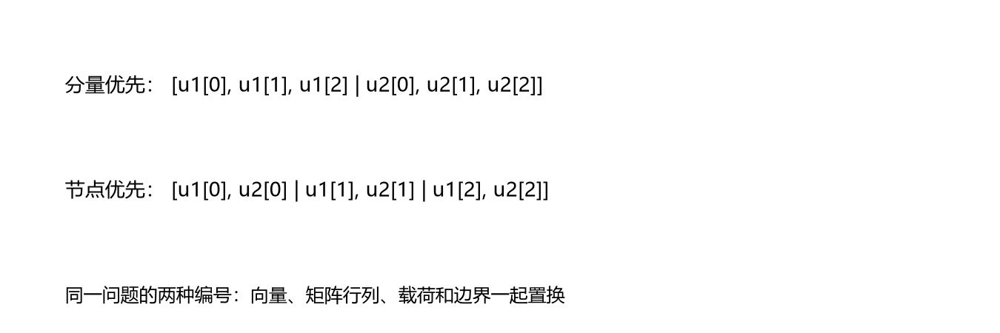
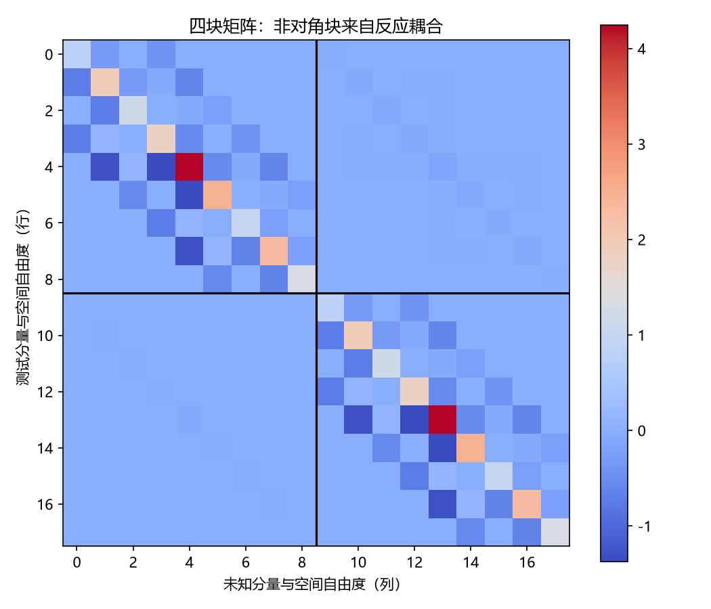

# 乘积空间与块装配

[课程入口](../README.md) · [上一专题：耦合模型与向量弱问题](01-耦合模型与向量弱问题.md) · [下一专题：求解与误差验证](03-求解实现与误差验证.md)

耦合方程的每个分量都定义在同一个区域。有限元离散应保留这一共享几何，同时给不同场分配独立的系数。代数系统中的块结构，正是这种“同一空间、多个分量”的表达。

[耦合模型](01-耦合模型与向量弱问题.md)中第一条方程含有第二个场，第二条又含有第一个场。有限元矩阵必须保留这两种作用的方向；一份全局编号约定，便能同时确定块的位置和块内条目的位置。

## 一张网格上的多个场

在与FEM-101相同的相容三角剖分上取连续 $\mathbb{P}_1$ 标量空间 $S_h$，定义 $\boldsymbol{S}_h=(S_h)^m$、$\boldsymbol{V}_h=\boldsymbol{S}_h\cap V$。本例常数提升可在每个空间精确表示。离散问题是求 $\boldsymbol{u}_h\in\boldsymbol{\ell}+\boldsymbol{V}_h$，使
$\mathcal A(\boldsymbol{u}_h,\boldsymbol{v}_h)=L(\boldsymbol{v}_h)$ 对所有 $\boldsymbol{v}_h\in\boldsymbol{V}_h$ 成立。

设标量基为 $\varphi_j$，向量基就是 $\varphi_j\boldsymbol{e}_r$，其中 $\boldsymbol{e}_r$ 是分量标准基。因此一张含 $N$ 个标量自由度的网格，共有 $mN$ 个未知系数；三角形 $\mathbb{P}_1$ 两分量局部有六个系数，几何仍只有一个三角形。

对于两分量，程序采用分量优先编号

$$
\boldsymbol{U}=(U_{1,0},\ldots,U_{1,N-1},U_{2,0},\ldots,U_{2,N-1})^T.
\tag{10}
$$

这里 $\boldsymbol{U}$ 是有限维系数向量，$U_{r,j}$ 是其标量条目，场函数由 $u_{r,h}=\sum_{j=0}^{N-1}U_{r,j}\varphi_j$ 重建。后文 $\boldsymbol{U}_r$ 表示第 $r$ 个分量的整组系数，$\boldsymbol{U}_{r,I}$ 表示其中的内部系数。

数学分量编号 $r=1,\ldots,m$，标量全局自由度编号 $j=0,\ldots,N-1$，因此全局位置为 $(r-1)N+j$。代码分量索引取 `r0=r-1`、`s0=s-1`，代码中的 `C[r0,s0]` 对应数学系数 $C_{rs}$。如果物理点值数组每行对应一个点、每列对应一个分量，转换为该存储顺序需用 `values.T.reshape(-1)`。直接 `values.reshape(-1)` 则是节点优先。两种顺序都合法。若置换矩阵 $\boldsymbol{Q}$ 把分量优先系数变成节点优先系数 $\widetilde{\boldsymbol{U}}=\boldsymbol{Q}\boldsymbol{U}$，方程必须相应写成

$$
(\boldsymbol{Q}\boldsymbol{A}\boldsymbol{Q}^T)\widetilde{\boldsymbol{U}}=\boldsymbol{Q}\boldsymbol{F}.
$$

这来自 $\boldsymbol{U}=\boldsymbol{Q}^T\widetilde{\boldsymbol{U}}$，其中 $\boldsymbol{Q}^T\boldsymbol{Q}=\boldsymbol{I}$。因此编号变化同时影响未知量、测试方程以及载荷；边界编号与值也按相同规则重排。矩阵维数相同只能说明元素数目相容，不能说明每个位置仍指向原来的物理量。

以三个空间自由度、两分量为例，设同一行给出同一点的两个浓度：

```python
values = np.array([[10., 20.], [11., 21.], [12., 22.]])
U = values.T.reshape(-1)        # [10, 11, 12, 20, 21, 22]
by_component = U.reshape(2, 3) # 每行保存一个分量的系数
restored = by_component.T      # 恢复为空间点×分量
```

这里的三个空间自由度只是编号说明，数值不参与后文制造解实验。若一张实际网格的标量空间有 $N$ 个自由度，把两行 `by_component` 分别放入标量有限元函数，就恢复了 $u_{1,h}$、$u_{2,h}$。两函数依然共享同一组 $\varphi_j$；`reshape` 只解释系数的位置，并没有执行空间插值。对 $\mathbb{P}_1$，系数恰为顶点值；更高阶的系数对应空间插值点，不能再只按网格顶点读取。



图1　分量优先使块矩阵直接可见；节点优先把同一空间位置的不同分量放在一起。

```python
scalar = LagrangeFESpace(mesh, p=1)
space = TensorFunctionSpace(scalar, shape=(2, -1))
```

`shape` 中的 `2` 表示两个分量，`-1` 是标记标量自由度轴位置的约定，不是负的维数。`(2,-1)` 将标量自由度轴放在末尾，形成分量优先排列；`(-1,2)` 则对应节点优先排列。

数学记号 $\boldsymbol{C}$、$\boldsymbol{U}$、$\boldsymbol{\beta}$ 分别对应程序的 `C`、系数数组与 `velocity`；代码变量不使用数学字体。

`scalar` 提供几何、基函数与空间编号；`TensorFunctionSpace` 组合两份空间并确定存储顺序。完整程序见[双分量耦合实验](../labs/双分量耦合实验.py)。

## 单元上的分量作用与全局累加

参考单元映射仍为 $\boldsymbol{x}=\boldsymbol{P}_0+\boldsymbol{J}_K\widehat{\boldsymbol{x}}$，局部基函数梯度为 $\boldsymbol{J}_K^{-T}\widehat\nabla\widehat\varphi_i$。增加分量不会改变这个几何变换。在第 $r$ 个测试分量上取局部基函数 $\varphi_i\boldsymbol{e}_r$，将第 $s$ 个未知场按 $\varphi_j\boldsymbol{e}_s$ 展开，就得到：

$$
(\boldsymbol{A}_K^{rs})_{ij}=\delta_{rs}\int_K[a\nabla\varphi_j\cdot\nabla\varphi_i+
(\boldsymbol{\beta}\cdot\nabla\varphi_j)\varphi_i]+\int_KC_{rs}\varphi_j\varphi_i.
\tag{11}
$$

块行 $r$ 是测试分量，块列 $s$ 是试探分量；每个块内部的行 $i$、列 $j$ 分别是测试、试探基函数。扩散和对流只进入对角块，因为本模型没有跨分量导数耦合。反应项可进入所有块。

若 $m_K(i)$ 是标量局部到全局映射，则分量优先下的向量映射为 $(r-1)N+m_K(i)$。因此每份局部贡献累加到

$$
A_{(r-1)N+m_K(i),\ (s-1)N+m_K(j)}\mathrel{+}=(\boldsymbol{A}_K^{rs})_{ij}.
\tag{12}
$$

以一个 $\mathbb{P}_1$ 三角形为例，局部标量编号 $i,j\in\{0,1,2\}$，分量局部编号可写成 $\alpha=3(r-1)+i$、$\beta=3(s-1)+j$。局部向量矩阵为 $6\times6$，它的第 $(\alpha,\beta)$ 个元素就是 $(\boldsymbol{A}_K^{rs})_{ij}$；从这个局部矩阵到全局矩阵，只需把两侧局部编号分别替换成式（12）的全局位置。

若相邻单元都含有空间自由度 $j$，它们在第一分量的贡献累加到位置 $j$，在第二分量则累加到位置 $N+j$。相同几何点的两个场有不同系数，但两个单元对同一个场的系数必须共享。对应的向量基限制在单元上后，正是参考单元的标量基乘分量标准向量。

共享空间顶点在同一分量内共用一个未知量，而不同分量的同一空间顶点仍是两个未知量。式（12）同时解释空间共享与分量耦合，无需把不同分量建成不同网格。

对于常矩阵 $\boldsymbol{C}$，记标量质量矩阵为 $\boldsymbol{M}$，标量扩散矩阵为 $\boldsymbol{K}_a$，对流矩阵为 $\boldsymbol{B}$，则

$$
\boldsymbol{A}=\boldsymbol{I}_m\otimes(\boldsymbol{K}_a+\boldsymbol{B})+\boldsymbol{C}\otimes \boldsymbol{M}.
\tag{13}
$$

这是分量优先编号下的Kronecker写法。位置相关的 $\boldsymbol{C}(\boldsymbol{x})$ 必须留在各块积分内，不能用一个常矩阵与同一个质量矩阵相乘代替。

若从两条离散弱方程直接写出系统，记 $R^{rs}_{ij}=\int_\Omega C_{rs}\varphi_j\varphi_i$，有

$$
\begin{pmatrix}
\boldsymbol{K}_a+\boldsymbol{B}+\boldsymbol{R}^{11}&\boldsymbol{R}^{12}\\\boldsymbol{R}^{21}&\boldsymbol{K}_a+\boldsymbol{B}+\boldsymbol{R}^{22}
\end{pmatrix}
\begin{pmatrix}\boldsymbol{U}_1\\\boldsymbol{U}_2\end{pmatrix}
=\begin{pmatrix}\boldsymbol{F}_1\\\boldsymbol{F}_2\end{pmatrix}.
$$

每个 $\boldsymbol{R}^{rs}$ 是 $N\times N$ 的空间矩阵。取测试函数 $(\varphi_i,0)$ 产生第一块行，取 $(0,\varphi_i)$ 产生第二块行，所以块行的来源是分量测试，块列的来源是未知场的展开。本例 $\boldsymbol{R}^{12}=-\boldsymbol{M}$、$\boldsymbol{R}^{21}=-\boldsymbol{M}/2$，两块的次序必须与这两种物理作用一致。



图2　小网格的完整装配矩阵，横线与竖线标出两个分量块。非对角块由 $C_{12}\boldsymbol{M}$、$C_{21}\boldsymbol{M}$ 形成，二者不同。

## 用FEALPy表达块的数学含义

```python
for r0 in range(2):
    row = []
    for s0 in range(2):
        form = BilinearForm(scalar)
        form.add_integrator(ScalarMassIntegrator(coef=float(C[r0,s0]), q=5))
        if r0 == s0:
            form.add_integrator(ScalarDiffusionIntegrator(coef=1., q=5))
            form.add_integrator(ScalarConvectionIntegrator(coef=velocity, q=5))
        row.append(form)
    forms.append(row)
A = BlockForm(forms).assembly()
```

`forms` 从空列表开始；每个 `row` 对应一条方程。质量积分器计算 $C_{rs}\varphi_j\varphi_i$，只把给定常矩阵中的一个元素传入；`r0==s0` 时才加入扩散和对流。对流积分器的梯度作用在试探侧。若反应矩阵不对称，$\boldsymbol{A}_{12}$ 与 $\boldsymbol{A}_{21}$ 的数值不同；即使各自的标量质量矩阵是对称的，完整反应矩阵也可以不对称。`BlockForm` 利用各块空间大小偏移全局行列，把矩阵块组合起来。

第 $r$ 条载荷由 `ScalarSourceIntegrator(source=component_source(r0,C), q=7)` 计算，其中回调返回数学分量 $r=r_0+1$ 的源项（代码索引为 `r0`），随后 `np.concatenate(rhs)` 按分量拼接。源项的分量轴不等于坐标轴。完整程序的点值为“单元×积分点×分量”，梯度再增加最后一个空间方向轴。

这里 `q` 是求积规则参数，`p=1` 是空间次数。当前三角形归一化求积权重和为1，单元面积另乘。实际系数与空间确定后再选择积分精度，不能把高阶空间简单配上固定不足的求积。

### 反应强度随位置变化时

常系数时 $C_{rs}$ 可移出积分，空间变系数则对不同位置的基函数乘积赋予不同权重。以两个单元共享顶点为例，该顶点对应的条目仍需累加，但每个单元积分要使用该单元求积点处的 $C_{rs}(\boldsymbol{x})$。

源CDR项目的 `reaction_coef(points, t)` 返回每点一个 $m\times m$ 矩阵；它的 `at_time` 固定时间并提取代码索引 `(r0,s0)`，再把标量回调传给质量积分器。稳态课程的 `component_field` 仅提取分量，省去时间绑定。对应的核心操作是

```python
@cartesian
def c12(points):
    return reaction_coef(points)[..., 0, 1]

form12 = BilinearForm(scalar)
form12.add_integrator(ScalarMassIntegrator(coef=c12, q=5))
```

此片段说明已有项目的数据适配方式：`reaction_coef` 必须由模型提供，返回形状为 `points.shape[:-1] + (m,m)`，它不是FEALPy内置函数。本章随附实验采用常矩阵，不包含这一扩展示例的运行结果。当前实验的 `float(C[r0,s0])` 只适用于常矩阵，推广到 $\boldsymbol{C}(\boldsymbol{x})$ 时需改成这样的回调，并核对相应求积精度。

例如在单位线段上取 $C_{12}(x)=x$、$\mathbb{P}_1$ 基函数 $1-x,x$，直接积分可得

$$
\boldsymbol{R}^{12}=\begin{pmatrix}\int_0^1x(1-x)^2&\int_0^1x^2(1-x)\\
\int_0^1x^2(1-x)&\int_0^1x^3\end{pmatrix}
=\frac1{12}\begin{pmatrix}1&1\\1&3\end{pmatrix}.
$$

两个对角元不同，因此无法用一个常数乘该单元的质量矩阵替代。这个积分例说明变系数处理的必要性；它不改变本文制造解和后续误差表。

## 将已知的边界场移入内部方程

全局边界集合同时包含两种浓度的边界自由度。按内部 $I$ 与边界 $D$ 分块后仍有

$$
\boldsymbol{A}_{II}\boldsymbol{U}_I=\boldsymbol{F}_I-\boldsymbol{A}_{ID}\boldsymbol{g}_D.
\tag{14}
$$

$\boldsymbol{A}_{ID}$ 包含非对角反应块，因此第二分量的已知边界可能进入第一分量的内部右端。将两条方程各自只处理对角块，会漏掉这些贡献。

进一步按分量展开内部方程，可以看清每项边界贡献：

$$
\begin{aligned}
(\boldsymbol{A}_{11})_{II}\boldsymbol{U}_{1,I}+(\boldsymbol{A}_{12})_{II}\boldsymbol{U}_{2,I}
&=\boldsymbol{F}_{1,I}-(\boldsymbol{A}_{11})_{ID}\boldsymbol{g}_{1,D}-(\boldsymbol{A}_{12})_{ID}\boldsymbol{g}_{2,D},\\
(\boldsymbol{A}_{21})_{II}\boldsymbol{U}_{1,I}+(\boldsymbol{A}_{22})_{II}\boldsymbol{U}_{2,I}
&=\boldsymbol{F}_{2,I}-(\boldsymbol{A}_{21})_{ID}\boldsymbol{g}_{1,D}-(\boldsymbol{A}_{22})_{ID}\boldsymbol{g}_{2,D}.
\end{aligned}
$$

将边界已知值组合为长向量 $\boldsymbol{G}$，并令其内部条目为零。定义对角投影矩阵 $\boldsymbol{P}_I$ 保留内部条目，$\boldsymbol{P}_D$ 保留边界条目，满足 $\boldsymbol{P}_I+\boldsymbol{P}_D=\boldsymbol{I}_{mN}$。完整布局下的边界系统可以写成

$$
\widehat{\boldsymbol{A}}=\boldsymbol{P}_I\boldsymbol{A}\boldsymbol{P}_I+\boldsymbol{P}_D,\qquad
\widehat{\boldsymbol{F}}=\boldsymbol{P}_I(\boldsymbol{F}-\boldsymbol{A}\boldsymbol{G})+\boldsymbol{P}_D\boldsymbol{G}.
$$

内部行恰好得到式（14），边界行则是 $\boldsymbol{U}_D=\boldsymbol{g}_D$。矩阵和右端必须使用同一个边界集合；`boundary` 掩码描述集合，`exact(points)` 描述数值，二者不承担同一职责。这个表达也说明，强制边界后不再要求原矩阵的边界行满足原来的平衡方程。

本例 $\boldsymbol{A}_{12}=-\boldsymbol{M}$，因此第一条右端包含 $+\boldsymbol{M}_{ID}\boldsymbol{g}_{2,D}$；$\boldsymbol{A}_{21}=-\boldsymbol{M}/2$，第二条右端包含 $+\tfrac12\boldsymbol{M}_{ID}\boldsymbol{g}_{1,D}$。这些项虽由质量型积分产生，仍与边界浓度相关。先把所有块装配完，再调用整体边界消元，便会自然包含这些影响。

假设一个标量空间的边界掩码为 `[True, False, True]`，分量优先的双分量掩码应重复为 `[True, False, True, True, False, True]`。两个分量的边界值分别取1与2时，相应长向量必须在前一组边界位置填1、后一组填2。掩码可以重复，具体边界值由各分量数据决定。

```python
boundary = np.tile(scalar.is_boundary_dof(), 2)
Ab, Fb = DirichletBC(space, gd=exact, threshold=boundary).apply(A, F)
uh = space.function()
uh[:] = spsolve(Ab, Fb, solver='scipy')
by_component = uh[:].reshape(2, -1)
```

`exact` 这里只提供每个边界点的两种浓度。库保留完整系数布局，修正右端并施加边界方程。强制性保证内部系统可逆；但矩阵一般不对称，不应只因扩散部分对称就使用要求对称正定的CG。

两种离散提升只要具有相同边界节点值，其差就属于 $\boldsymbol{V}_h$。对应离散解之差也属于该空间，两方程相减并取此差为测试函数，强制性迫使其为零。这解释了理论上的常数提升与代码中的边界节点提升为何给出同一解。


装配与边界条件共同确定了实际求解的方程。求出的系数仍带有有限维近似误差，块位置和分量排列也需要独立核对。[求解实现与误差验证](03-求解实现与误差验证.md)给出相应理论和计算依据。
