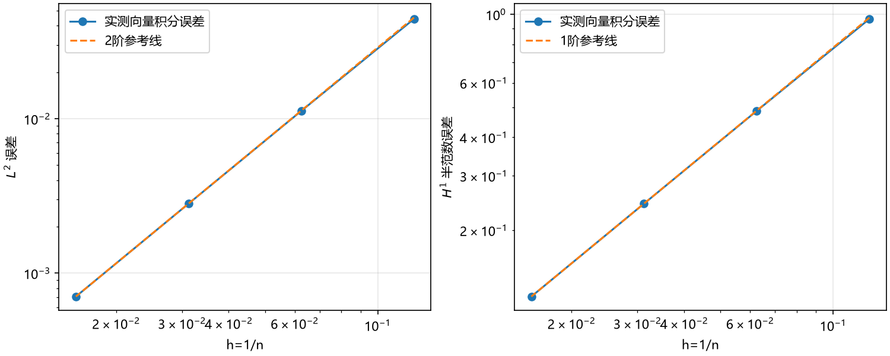

# 求解实现与误差验证

[课程入口](../README.md) · [上一专题：乘积空间与块装配](02-乘积空间与块装配.md)

联立系统求解后得到的是两组有限元系数。它们是否满足边界、是否对应正确的块矩阵、是否随加密逼近原解，需要不同的证据。误差理论为加密实验提供预期，结构核对则帮助确认程序计算的确实是指定的离散问题。

## 从模型数据到两个有限元场

[双分量耦合实验](../labs/双分量耦合实验.py)中的 `solve(n, coef=C)` 接收每方向剖分段数与常反应矩阵。`exact` 返回每个物理点的两分量值，`gradient` 在分量轴之后增加空间方向轴。`component_source(r0, coef)` 根据同一真解、完整反应矩阵和给定速度制造数学编号为 $r=r_0+1$ 的源项，避免模型改动后继续使用旧源项。这里 `r0` 表示从零开始的代码索引；随附程序中的参数名写作 `r`，含义相同。

空间、块形式和边界代码的数学解释见[乘积空间与块装配](02-乘积空间与块装配.md)。求解后，系数按 `(2, N)` 还原只是存储视图；单元内部的函数和梯度仍由有限元空间的基函数计算。

```python
bc, weights = mesh.quadrature_formula(7).get_quadrature_points_and_weights()
points = mesh.bc_to_point(bc)
value_error = uh.value(bc) - exact(points)
gradient_error = uh.grad_value(bc) - gradient(points)
```

重心坐标 `bc` 用于空间求值，物理坐标 `points` 用于模型数据函数。`value_error` 的轴为单元、求积点、分量；`gradient_error` 的末轴还区分空间方向。若单元数为 $N_K$、求积点数为 $N_Q$，`value_error` 的形状为 $(N_K,N_Q,m)$，`gradient_error` 为 $(N_K,N_Q,m,d)$。记单元索引为 $k$、求积点索引为 $q$，归一化权重为 $w_q$，则

$$
E_{0,r}^2\approx\sum_{k=1}^{N_K}|K_k|\sum_{q=1}^{N_Q}w_q\,
|u_r(\boldsymbol{x}_{kq})-u_{r,h}(\boldsymbol{x}_{kq})|^2,
$$

$$
E_{1,r}^2\approx\sum_{k=1}^{N_K}|K_k|\sum_{q=1}^{N_Q}w_q
\sum_{\alpha=1}^d|\partial_\alpha u_r(\boldsymbol{x}_{kq})-\partial_\alpha u_{r,h}(\boldsymbol{x}_{kq})|^2.
$$

代码对单元、求积点及空间方向求和，保留分量轴，才能先得到每个场的误差。整体误差再对分量平方和开方。二维双分量问题中 $m=d=2$，即使交换两个长度为2的轴后形状不变，物理含义也可能改变；求和下标应从上面的定义确定。

## 求解程序与模型数据各自承担什么

本实验的 `component_source(r0, coef)`、制造解表达式和反应矩阵属于模型数据；`LagrangeFESpace`、`TensorFunctionSpace`、积分器、`BlockForm`、`DirichletBC` 与 `spsolve` 来自FEALPy。程序把它们组织成当前的稳态求解，没有把模型推导交给库自动完成。

原CDR项目把同样的分工写成 `CDRModel`/`SymbolicCDR` 与 `CDRSolver` 两层：模型在每批点上提供扩散、速度、反应矩阵、源项和边界；求解器负责空间、积分和联立求解。`SymbolicCDR` 通过SymPy制造源项与精确梯度，自动求导发生在模型层；`@cartesian` 只声明物理坐标约定。若没有真解，模型仍可直接提供源项与边界，求解并不依赖精确解，只有误差比较需要它。

本章的程序保留一份透明的固定模型入口，便于对照公式阅读。它不直接接收原项目的PDE数据类。原CDR `assemble(t)` 返回空间矩阵、容量矩阵和载荷 `A,M,F`，稳态部分只使用 `A,F`；本章的 `solve` 则直接完成空间装配、边界和求解。阅读两者时需按实际函数签名区分，不能把原项目的时间接口套到当前实验上。

## 近似误差由什么控制

在相同边界提升、精确积分的情形，连续与离散方程相减得到

$$
\mathcal A(\boldsymbol{e},\boldsymbol{v}_h)=0,\quad\boldsymbol{e}=\boldsymbol{u}-\boldsymbol{u}_h.
\tag{15}
$$

对任意同边界的 $\boldsymbol{z}_h$，利用强制性、正交性与连续性：

$$
a_0\|\boldsymbol{e}\|_V^2\le\mathcal A(\boldsymbol{e},\boldsymbol{u}-\boldsymbol{z}_h)
\le c_A\|\boldsymbol{e}\|_V\|\boldsymbol{u}-\boldsymbol{z}_h\|_V.
$$

这个等式链使用了 $\boldsymbol{z}_h-\boldsymbol{u}_h\in\boldsymbol{V}_h$：将
$\boldsymbol{e}=(\boldsymbol{u}-\boldsymbol{z}_h)+(\boldsymbol{z}_h-\boldsymbol{u}_h)$
代入 $\mathcal A(\boldsymbol{e},\boldsymbol{e})$，第二项由Galerkin正交性消失。若 $\boldsymbol{e}\ne0$，除去误差范数并对 $\boldsymbol{z}_h$ 取下确界，得到

$$
\|\boldsymbol{u}-\boldsymbol{u}_h\|_V\le\frac{c_A}{a_0}
\inf_{\boldsymbol{z}_h\in\boldsymbol{\ell}+\boldsymbol{V}_h}
\|\boldsymbol{u}-\boldsymbol{z}_h\|_V.
$$

若误差为零，结论自然成立。这里 $c_A$ 是连续性常数，$a_0$ 是强制性下界；这里的常数仅依赖系数界、区域与网格正则性，不随 $h$ 改变。故向量误差受最佳近似误差控制。形状正则网格、各分量 $H^2$ 正则时，逐分量插值再平方求和给出

$$
\|\boldsymbol{e}\|_V\le c_{\mathrm{err}}h\Big(\sum_r|u_r|_{H^2}^2\Big)^{1/2}.
\tag{16}
$$

## 从能量误差到平方积分误差

梯度误差的一阶估计尚不足以推出函数值误差的二阶估计。这一阶差异来自伴随系统的 $H^2$ 正则性。求 $\boldsymbol{z}\in V$ 满足
$\mathcal A(\boldsymbol{v},\boldsymbol{z})=(\boldsymbol{e},\boldsymbol{v})$。未知量在第二个槽中，因此伴随的反应矩阵是 $\boldsymbol{C}^T$，常速度对流符号反转。对 $[H^2(\Omega)]^m$ 使用分量平方和范数。若 $\|\boldsymbol{z}\|_{H^2}\le c_{\mathrm{reg}}\|\boldsymbol{e}\|_{L^2}$，取 $\boldsymbol{v}=\boldsymbol{e}$，再用插值 $I_h\boldsymbol{z}\in\boldsymbol{V}_h$ 消去离散部分，得到

$$
\|\boldsymbol{e}\|_{L^2}^2=\mathcal A(\boldsymbol{e},\boldsymbol{z}-I_h\boldsymbol{z})
\le c_{\mathrm{err}}h\|\boldsymbol{e}\|_V\|\boldsymbol{e}\|_{L^2}.
\tag{17}
$$

伴随问题的存在性也可由Lax–Milgram说明：交换双线性型的两个参数得到转置双线性型，其连续性与对角值的强制性均保持。对流不对称只影响伴随算子的具体形式，不破坏这个论证。

以常系数为例，对零迹 $\boldsymbol{v}$ 再次分部积分，可把伴随强形式写为

$$
-\Delta\boldsymbol{z}-\boldsymbol{\beta}\cdot\nabla\boldsymbol{z}+\boldsymbol{C}^T\boldsymbol{z}=\boldsymbol{e},
\qquad\boldsymbol{z}|_{\partial\Omega}=0.
$$

若速度不是常数，伴随对流应写成 $-\nabla\cdot(\boldsymbol{\beta} z_r)$，展开时还包含 $-(\nabla\cdot\boldsymbol{\beta})z_r$。转置 $\boldsymbol{C}$ 来自
$\sum_{r,s}C_{rs}v_sz_r=\sum_s v_s(\boldsymbol{C}^T\boldsymbol{z})_s$，这与块行、块列的角色是一致的。

式（17）中 $\boldsymbol{z}-I_h\boldsymbol{z}$ 的一个 $h$ 来自插值估计，$\|\boldsymbol{e}\|_V$ 的另一个 $h$ 来自式（16）。约去非零的 $\|\boldsymbol{e}\|_{L^2}$ 后，明确得到

$$
\|\boldsymbol{e}\|_{L^2}\le c_{\mathrm{dual}}h\|\boldsymbol{e}\|_V
\le c_{0}h^2\Big(\sum_r|u_r|_{H^2}^2\Big)^{1/2}.
$$

凸正方形、常系数标量主部和有界零阶耦合的本例满足所需椭圆正则性；一般区域的适定性本身不能推出该阶。程序的常系数双线性项求积精确，正弦源项及误差用高精度规则近似；若积分误差不可忽略，需要加入一致性误差项。

## 结构检查与制造解验证

整体残差很小并不能证明块放对了，因为错误的矩阵也能被精确求解。本实验用三项独立结构检查定位块装配与编号问题：常矩阵反应的块装配与[上一专题](02-乘积空间与块装配.md)的式（13）对照；分量优先与节点优先共同置换矩阵行列、向量后，检查矩阵作用一致；去掉非对角反应后，检查跨分量块退化为零。随后用非零边界制造解检查各分量边界和原系统内部行残差。

各分量误差定义为

$$
E_{0,r}^2=\int_\Omega|u_r-u_{r,h}|^2,\quad
E_{1,r}^2=\int_\Omega|\nabla u_r-\nabla u_{r,h}|^2,
\quad E_0^2=\sum_rE_{0,r}^2,\quad E_1^2=\sum_rE_{1,r}^2.
\tag{18}
$$

式（18）要求在单元内部求积。节点值差的平均不含单元尺度与积分权重，因而无法给出同一范数。观测阶为 $\log_2(E(h)/E(h/2))$，本章以 $h=1/n$ 表示每方向间距；它与单元最大直径只差常数，不影响阶。



图3　整体误差与理论参考斜率。每个分量的误差同时保留在[CSV数据](../labs/results/收敛结果.csv)，避免一个较小分量被总范数掩盖。

本次实际结果为：

| n | 总自由度 | 向量L²误差 | 观测阶 | 向量H¹半范数误差 | 观测阶 |
|---|---:|---:|---:|---:|---:|
| 8 | 162 | 4.43118e-2 | — | 9.65931e-1 | — |
| 16 | 578 | 1.12395e-2 | 1.979 | 4.86480e-1 | 0.990 |
| 32 | 2178 | 2.82025e-3 | 1.995 | 2.43683e-1 | 0.997 |
| 64 | 8450 | 7.05715e-4 | 1.999 | 1.21897e-1 | 0.999 |

边界误差均为0，内部归一化残差最大1.95e-13。块装配与Kronecker构造的最大差4.44e-16，排列与解耦检查的差为0。

从课程根目录运行 `python labs/双分量耦合实验.py` 可生成结果与三幅图。图2只为观察小系统的块结构，求解和误差实验使用逐级加密网格。数值结果与验证阈值见[验证说明](../tests/README.md)。

### 解耦对照与误差比较使用不同的数据约束

去掉非对角反应后的矩阵成为块对角阵；每个场只受自己的空间算子、对角反应和源项驱动。这个结构退化可以检查“有没有残留的错误非对角块”。当前程序的解耦核对正是检查这一点，它不等于已经对一组固定外源做过完整的耦合效应实验。

若要研究耦合怎样改变浓度，应该固定源项、边界和其他系数，仅改变非对角反应。第二个场即使没有独立外源，也可能由第一场的转化而非零；相应差异是两个不同模型的响应。若要核对实现的精度，则应为每个反应矩阵重新制造源项，使目标真解保持不变，再比较误差。两种比较可以使用同一个网格，却不共享“哪个函数是真解”的前提。

这一差别还影响结果表的解释。本文制造解的第二分量是第一分量的两倍，但反应矩阵两行的作用不同，所以离散误差不必严格满足二倍关系。表中的向量范数综合了两分量，CSV保留分量误差，便于识别某个场是否因幅度较小而被整体误差掩盖。

### 自主理解

若去掉所有非对角项，却保持[模型专题](01-耦合模型与向量弱问题.md)式（5）的源项不变，是否还能使用该专题式（4）作真解？若只把系数向量改为节点优先排列，保持矩阵不变，为什么维数正确仍会求错方程？这些问题都可直接沿着模型、弱形式和编号定义回答。

## 范围与延伸

本章实现二维、双分量、连续P1元、共享常标量扩散和速度、常反应矩阵、全Dirichlet边界。一般 $m$ 分量的理论与块结构已经给出，未将它等同于本次新增程序已经验证任意维数与次数。空间变反应系数可逐块传入坐标回调；交叉扩散、非线性反应、压力约束和强对流稳定化需重新明确模型与相应验证。
