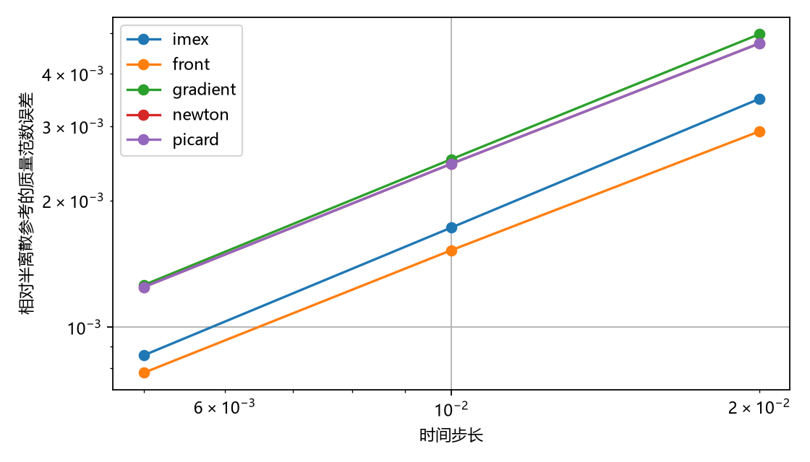
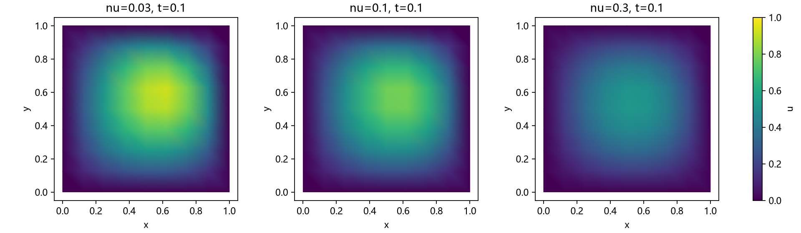

# 误差与计算证据

一个时间步算完后，我们得到了一组有限元系数。它是否接近PDE的解，要同时考虑空间近似、时间推进和代数求解。前面的空间离散与时间推进专题已经明确这三个阶段各自求解的方程，因此可以为每一种误差选择合适的参照对象。

本篇的理论与实验围绕同一个问题展开：观察到误差下降时，究竟是哪一部分在改善？固定空间系统可以识别时间误差，制造解可以比较与PDE解的差，而非线性残差则用于判断每步代数方程是否求准。

## 三种误差的分解

令 $u$ 为PDE解，$u_h(t)$ 为半离散ODE准确求解后得到的函数，$u_h^n$ 为时间离散方程的准确根所重建的函数，$\widetilde u_h^n$ 为实际迭代终值重建的函数。在 $t_n$ 处加减中间两项，得到
$$u(t_n)-\widetilde u_h^n=\underbrace{u(t_n)-u_h(t_n)}_{\text{空间误差}}+\underbrace{u_h(t_n)-u_h^n}_{\text{时间误差}}+\underbrace{u_h^n-\widetilde u_h^n}_{\text{代数误差}}.$$
三项有各自的来源，也需要不同的控制手段。减小时间步主要影响第二项，网格加密主要改善第一项，收紧非线性求解容差主要作用于第三项。从残差进一步估计系数误差，还依赖Jacobian的逆。

### 固定网格上的一阶时间误差

在内部自由度上写 $\dot{\boldsymbol{U}}=\boldsymbol{H}_h(t,\boldsymbol{U})$，用质量范数 $\|\boldsymbol{Z}\|_{\boldsymbol{M}}=(\boldsymbol{Z}^T\boldsymbol{M}\boldsymbol{Z})^{1/2}$。设精确轨迹及数值解位于一个有界集合，$\boldsymbol{H}_h$ 在其中对 $\boldsymbol{U}$ Lipschitz，常数为 $L_h$；轨迹有有界二阶时间导数。记系数误差 $\boldsymbol{e}^n=\boldsymbol{U}(t_n)-\boldsymbol{U}^n$；它与下文连续场的误差分解属于不同空间。后向Euler的局部缺陷 $\boldsymbol{\tau}^{n+1}$ 满足 $\|\boldsymbol{\tau}^{n+1}\|_{\boldsymbol{M}}\le C\Delta t$。相减得到
$$\boldsymbol{e}^{n+1}=\boldsymbol{e}^n+\Delta t[\boldsymbol{H}_h(t_{n+1},\boldsymbol{U}(t_{n+1}))-\boldsymbol{H}_h(t_{n+1},\boldsymbol{U}^{n+1})]+\Delta t\boldsymbol{\tau}^{n+1}.$$
因此在 $\Delta tL_h<1$ 时，
$$(1-\Delta tL_h)\|\boldsymbol{e}^{n+1}\|_{\boldsymbol{M}}\le\|\boldsymbol{e}^n\|_{\boldsymbol{M}}+C\Delta t^2.$$
若进一步取 $\Delta tL_h\le1/2$，递推与离散Gronwall估计给出固定终止时间上的 $O(\Delta t)$ 全局误差。递推中，每步的 $O(\Delta t^2)$ 缺陷累积到 $O(\Delta t)$，而Lipschitz估计控制这些缺陷的传播。这给出了在所述步长条件下一阶收敛的直接证明。

对一次冻结格式，光滑轨迹上 $\boldsymbol{U}(t_{n+1})-\boldsymbol{U}(t_n)=O(\Delta t)$，冻结因子造成的缺陷同样为 $O(\Delta t)$；在相应稳定性条件下仍是一阶。不同格式的稳定性常数及误差前因子可以不同，不能仅由一致性推出无条件收敛。

### 空间阶需要哪些条件

在正黏性、解足够光滑、形状正则网格、积分准确且非线性可受控的条件下，可用椭圆投影 $R_hu$ 分解
$$u-u_h=(u-R_hu)+(R_hu-u_h)=\rho+\theta.$$
投影误差由逼近理论控制；误差方程中扩散项给出 $\nu\|\nabla\theta\|^2$。对流差用二维Sobolev不等式、Young不等式及解的正则性估计，吸收部分梯度项后，可得到形如
$$\frac{d}{dt}\|\theta\|^2+\nu\|\nabla\theta\|^2\le C(t)\|\theta\|^2+C\bigl(\|\rho_t\|^2+\text{投影逼近项}\bigr).$$
时间可积的 $C(t)$、合适初值投影及椭圆正则性允许继续用Gronwall估计，得到标准光滑情形的 $L^2$ 空间阶 $p+1$。这一论证依赖投影误差与非线性项的控制。黏性减小时，Young不等式中吸收梯度项所需的常数会增大；解的导数变大时，非线性误差的系数也会增大。光滑、适度黏性的算例因此适合作为检验理论阶的起点。

可以在明确条件下把上面的能量估计写得更具体。取Ritz投影 $R_hu\in V_h$，满足 $(\nabla(u-R_hu),\nabla v_h)=0$，$v_h\in V_h$。假定 $u,u_h$ 在所讨论时间内有网格一致的 $L^\infty$ 界 $A_*$，且投影误差与时间导数满足所需逼近估计。相减连续与半离散方程，在 $v_h=\theta$ 处得
$$(\theta_t,\theta)+\nu|\theta|_1^2=-(\rho_t,\theta)-(uD_\beta u-u_hD_\beta u_h,\theta).$$
利用常方向下的守恒表达，非线性差可写成
$$uD_\beta u-u_hD_\beta u_h=\tfrac12D_\beta[(u+u_h)(\rho+\theta)].$$
因 $\theta$ 的边界迹为零，分部积分给出
$$|(uD_\beta u-u_hD_\beta u_h,\theta)|\le A_*|\boldsymbol{\beta}|(\|\rho\|_0+\|\theta\|_0)|\theta|_1.$$
再分别对这项及 $|\langle\rho_t,\theta\rangle|\le\|\rho_t\|_{V'}|\theta|_1$ 用Young不等式，吸收总共不超过一半的黏性项，得到
$$\frac{d}{dt}\|\theta\|_0^2+\nu|\theta|_1^2\le C_*\bigl(\|\theta\|_0^2+\|\rho\|_0^2+\|\rho_t\|_{V'}^2\bigr).$$
$C_*$ 依赖黏性、幅值界与方向。Gronwall估计把 $\|\theta(t)\|_0$ 归结为初始投影差以及 $\rho,\rho_t$ 的时间积分。若这几项均具有 $O(h^{p+1})$ 的适当范数界，便得到 $L^2$ 空间误差 $O(h^{p+1})$。这段论证说明需要哪些输入：仅给出 $u$ 光滑还不够，还要保证数值解的有界性、投影逼近和初始误差受控。

对于一般非零边界，先提升后再定义零边界Ritz投影，还要估计提升近似及其时间导数。本课齐次边界的制造解避免了这一附加误差。正文采用的是抛物能量论证；若改用伴随技巧争取更强范数或更精细常数，还需另列相应伴随问题的正则性条件。

下面的联合加密同时缩小时间步，其数据不能独立证明空间阶。若要隔离空间误差，应高精度积分各网格上的半离散ODE，或继续缩小时间步确认误差进入平台。

### 完整残差怎样联系代数误差

在一个时间层中，令 $\boldsymbol{W}_*$ 为全隐式方程的准确根，$\widetilde{\boldsymbol{W}}$ 为迭代终值。由有限维微积分基本定理，
$$\boldsymbol{R}(\widetilde{\boldsymbol{W}})-\boldsymbol{R}(\boldsymbol{W}_*)=\overline{\boldsymbol{J}}(\widetilde{\boldsymbol{W}}-\boldsymbol{W}_*),\qquad \overline{\boldsymbol{J}}=\int_0^1\boldsymbol{J}_R(\boldsymbol{W}_*+s(\widetilde{\boldsymbol{W}}-\boldsymbol{W}_*))\,\mathrm ds.$$
若这条线段上的平均Jacobian可逆且其逆范数受控，就有
$$\|\widetilde{\boldsymbol{W}}-\boldsymbol{W}_*\|_2\le\|\overline{\boldsymbol{J}}^{-1}\|_2\|\boldsymbol{R}(\widetilde{\boldsymbol{W}})\|_2.$$
因此残差是可计算的停止量，而从它到实际系数误差的换算还包含矩阵条件。评价PDE误差时，仍应把容差取得足够小，使代数误差低于正在测量的空间或时间误差。

## 先验证非线性算子

程序 `nonlinear` 返回 $\boldsymbol{C},\boldsymbol{B},\boldsymbol{G}$。测试检查 $\boldsymbol{C}(\boldsymbol{U})=\boldsymbol{B}(\boldsymbol{U})\boldsymbol{U}=\boldsymbol{G}(\boldsymbol{U})\boldsymbol{U}$，并用独立中心差商核对
$$\frac{\boldsymbol{C}(\boldsymbol{U}+\varepsilon \boldsymbol{Z})-\boldsymbol{C}(\boldsymbol{U}-\varepsilon \boldsymbol{Z})}{2\varepsilon}\approx[\boldsymbol{B}(\boldsymbol{U})+\boldsymbol{G}(\boldsymbol{U})]\boldsymbol{Z}.$$
这里 $\boldsymbol{Z}$ 为给定系数扰动向量，$\varepsilon$ 是差商参数。检查覆盖一、二维P1/P2。中心差商直接对非线性向量施加扰动，因此能发现Jacobian中遗漏一个乘积导数的问题。一维三单元的独立手算结果还用于核对冻结梯度的一步，作为程序中的局部回归算例。

[验证程序](../tests/验证非线性.py)实际通过上述检查和六组二维联合加密。每个非线性时间步同时检查零边界与完整内部残差，衔接前一篇的停止判据。

## 固定半离散系统检验时间阶

以 $m$ 表示单位区间每方向的网格分段数（程序参数名为 `n`），它与物理时间层 $n$ 无关。固定二维 $m=8$、P1、$\nu=0.1$、零源、初值 $\sin(\pi x)\sin(\pi y)$、$T=0.1$。对同一半离散ODE用DOP853求高精度参考，容差 $\mathrm{rtol}=2\times10^{-11}$、$\mathrm{atol}=2\times10^{-13}$。参考右端通过分解内部质量矩阵后求解线性系统计算，不形成质量矩阵逆。

```python
mass = splu(fem.M[I][:, I].tocsc())
def rhs(t, interior):
    U = np.zeros(fem.N)
    U[I] = interior
    return mass.solve((-.1*(fem.K@U)-fem.nonlinear(U)[0])[I])
```

比较 $\Delta t=0.02,0.01,0.005$，误差为与该参考终值之差的质量范数。在这个比较中，所有方法共享同一网格、质量矩阵与非线性空间算子，误差因此主要来自时间离散。

令 $e_t(\Delta t)$ 表示固定空间系统上、时间步为 $\Delta t$ 时的终值误差。相邻两级步长的观测阶定义为

$$
q_t=\frac{\log\bigl(e_t(\Delta t_{\mathrm{粗}})/e_t(\Delta t_{\mathrm{细}})\bigr)}{\log(\Delta t_{\mathrm{粗}}/\Delta t_{\mathrm{细}})}.
$$

若误差主要为 $c\Delta t^q$，这个比值便接近 $q$。本实验每次把步长减半，分母为 $\log2$；表中的“最后观测阶”使用 $0.01$ 与 $0.005$ 两档误差计算。

| 方法 | 最细步长误差 | 最后观测阶 | 全部物理步的线性子求解次数 |
|---|---:|---:|---:|
| imex | 8.57712e-4 | 1.008 | 20 |
| front | 7.79661e-4 | 0.967 | 20 |
| gradient | 1.25945e-3 | 0.993 | 20 |
| Newton全隐式 | 1.24530e-3 | 0.973 | 60 |
| Picard全隐式 | 1.24530e-3 | 0.973 | 120 |



图1　同一半离散系统上的时间加密。Newton与Picard两条曲线重合，因为两者求解同一个全隐式格式。

表中的质量范数误差由有限元函数的积分定义：$\|\boldsymbol{Z}\|_{\boldsymbol{M}}^2=\boldsymbol{Z}^T\boldsymbol{M}\boldsymbol{Z}=\|\sum_jZ_j\varphi_j\|_{L^2}^2$。它与节点向量的欧氏范数不同，后者的大小还受节点数影响。固定同一个网格时，两者可能给出相近的时间观测阶；跨网格直接比较误差数值时，应保留积分范数的定义。

最细步长包含20个物理步；60与120分别是这20步内部累计的线性子求解次数。这里front误差较小是本算例的比较结果。若比较计算成本，还应在相近误差水平下记录总耗时、装配次数及线性系统规模。表中的子求解次数揭示了Picard与Newton单步工作的差别，但一次Jacobian装配与一次冻结矩阵更新的成本也可能不同。

可以把计算时间按实际操作理解。固定空间准备包含网格、基函数数据、质量与刚度矩阵；每个物理步还要评价载荷及所需的对流项；全隐式格式在该步内部重复装配、分解和求解，直到完整残差满足要求。稀疏直接法中的数值分解与分解后的回代也有不同成本。IMEX在固定步长下可复用左矩阵分解，冻结格式和Newton通常随状态更新数值矩阵，因此相同的“线性求解一次”未必代表相同工作量。

这也是高阶时间方法需要按目标误差比较的原因。较多阶段或更多单步工作可能换来较少物理步；较少Newton轮次也可能伴随更贵的Jacobian计算。当前表格只测得各格式在指定步长下的误差和子求解次数。要判断达到给定精度的总成本，应结合不同步长的数据，并计入相应装配、分解与回代时间。

结果中 `residual` 对应实际采用的时间方程；`full_residual` 则把解代入全隐式方程。一次冻结格式满足自己的线性方程时，全隐式残差可以非零，两列数值的差别反映了它们所求方程的差别。Newton/Picard两种残差一致且小于 $4\times10^{-13}$。全部格式的实际方程残差小于 $10^{-10}$。

## 制造解的空间—时间联合加密

取 $u_\star=e^{-t}\prod_{k=1}^d\sin(\pi x_k)$，方向为全1向量，得到
$$f=(-1+\nu d\pi^2)u_\star+u_\star\sum_k\partial_{x_k}u_\star.$$
固定二维 $\nu=0.1$、$T=0.02$，采用Newton全隐式；对 $m=4,8,16$，取 $\Delta t=0.02/(m/4)^{p+1}$，使一阶时间误差与预期空间误差一同缩小。

记 $e_{\mathrm{联合}}(m)$ 为上述网格与时间步配对下的积分误差。表中的观测阶按

$$
q_{\mathrm{联合}}=\frac{\log\bigl(e_{\mathrm{联合}}(m_{\mathrm{粗}})/e_{\mathrm{联合}}(m_{\mathrm{细}})\bigr)}{\log(m_{\mathrm{细}}/m_{\mathrm{粗}})}
$$

计算。网格尺度与 $1/m$ 成正比，$m$ 每次翻倍，因此分母同样为 $\log2$。这个量描述沿当前空间—时间加密路径的误差下降率，不能直接当作独立空间误差的收敛阶。

| 次数 | m | 时间步长 | 积分L²误差 | 观测阶 |
|---|---:|---:|---:|---:|
| P1 | 4 | 0.02 | 6.04395e-2 | — |
| P1 | 8 | 0.005 | 1.57267e-2 | 1.942 |
| P1 | 16 | 0.00125 | 3.97196e-3 | 1.985 |
| P2 | 4 | 0.02 | 4.03198e-3 | — |
| P2 | 8 | 0.0025 | 5.25516e-4 | 2.940 |
| P2 | 16 | 0.0003125 | 6.69555e-5 | 2.972 |

这支持当前光滑算例中联合误差的预期变化，不是独立空间误差测量。所有边界误差为0，完整非线性残差小于 $2\times10^{-16}$。数据由本目录程序实际重算，完整精度见[验证结果](../tests/验证结果.json)。

## 黏性与能量的解释

在特征长度 $L$、特征速度 $U_c$ 下取对流时间尺度 $L/U_c$，无量纲黏性系数为 $\nu/(U_cL)=1/\mathrm{Re}$。这说明“黏性变小”对应对流相对扩散变强；只有采用了这套尺度，才可直接将无量纲方程中的系数记作 $1/\mathrm{Re}$。

对一个空间尺度为 $\ell$、幅值为 $U_c$ 的变化，对流项量级约 $U_c^2/\ell$，扩散项约 $\nu U_c/\ell^2$。两者平衡的长度约为 $\nu/U_c$。黏性越小，需要分辨的局部变化可能越细，固定网格的分辨率便更值得注意。显式对流与扩散分别带来不同的步长限制；扩散改用隐式处理后，对流处理仍会影响稳定性。

固定 $m=8$、P1、$\Delta t=0.005$、$T=0.1$、零源及相同初值，以全隐式Newton比较 $\nu=0.03,0.1,0.3$。



图2　同一时刻、相同色标下的黏性对照。黏性较大时，扩散更强，峰值降低也更明显。

原有[二维交互演示的模型与验证说明](https://github.com/menghuainanfang/research-workspace/blob/main/学习练手项目/burgers-lab/README.md)可用于观察同一时刻的输运、平滑以及节点方程。该演示采用局部峰初值、不同黏性与终止时刻；本课采用正弦初值的受控时间实验，两处数据各自回答不同问题。页面读取已计算的物理帧，滑块经过的画面不增加数值时间步。

程序还记录每步的能量平衡缺口，保留所选格式的实际输运功。它核对离散方程与诊断公式是否一致；当有源或边界通量时，应加入相应输入，不能把平衡缺口小直接解释为能量耗散。

## 进一步使用这份程序

从课程根目录运行 `python tests/验证非线性.py` 与 `python labs/运行时间实验.py`。前者检验空间算子及制造解，后者产生时间对照、黏性图和精简数据。

可以选取最细时间步的front与Newton结果，结合代码写一段说明：两者各自解的方程是什么？为什么实际方程残差都很小，全隐式残差却不同？比较它们的误差和子求解次数时，还需要哪些信息才能判断计算成本？

若希望检验自己对装配的理解，可再从 $C_i(\boldsymbol{U})$ 的积分表达出发推导Jacobian，逐项指出它在 `nonlinear` 中的位置。将这个推导与中心差商核对联系起来，比记住 $\boldsymbol{B}+\boldsymbol{G}$ 的形式更有帮助。

## 范围

程序支持单位区间与正方形、标量连续P1/P2、固定正黏性、齐次Dirichlet及Euler族。三维、向量Burgers、非零时变边界、稳定化和移动网格不在本轮实现范围。BDF2、Crank–Nicolson与Runge–Kutta在第三篇说明其与空间算子的连接，本课程序与数据验证Euler族。强对流下的非物理振荡、正性保持与一般弱解存在理论需要另作分析。
