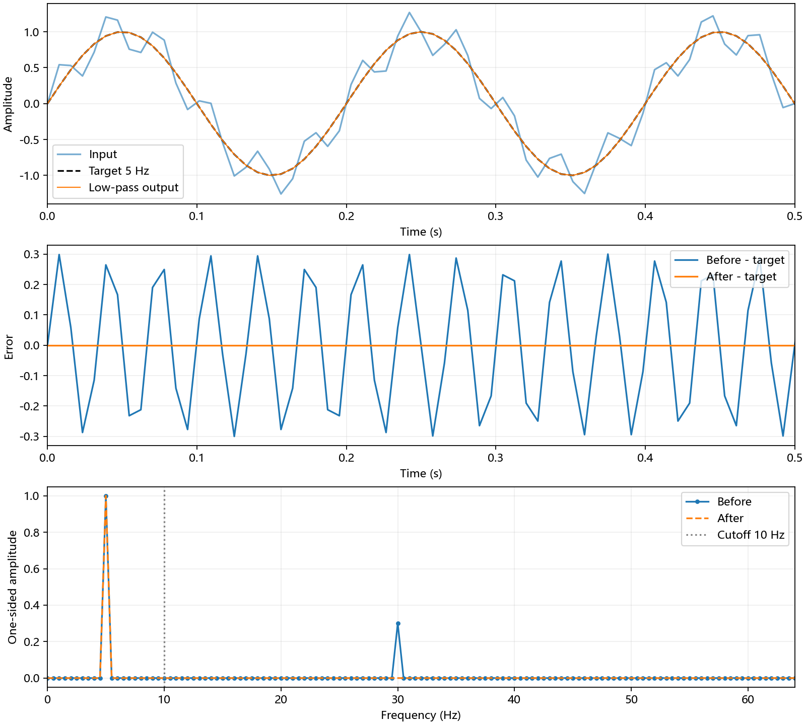

# 第24周学习笔记：从频率分解到 FFT

日期：2026年11月12日。阅读主线见[傅里叶分析学习讲义](./傅里叶分析学习讲义.md)。以下按学习中的关键问题记录概念、推导要点与本机实验结果。

## 1. 先弄清三种工具的对象

傅里叶级数处理周期函数，频率为 $k/T$，但频率分量一般有无穷多个：

$$c_k=\frac1T\int_0^T u(t)e^{-2\pi ikt/T}dt,\qquad
u(t)\sim\sum_{k\in\mathbb Z}c_ke^{2\pi ikt/T}.$$

连续傅里叶变换处理定义在实轴上的函数，频率连续：

$$\widehat u(f)=\int_{\mathbb R}u(t)e^{-2\pi ift}dt,\quad
u(t)=\int_{\mathbb R}\widehat u(f)e^{2\pi ift}df.$$

这里 $f$ 用Hz；角频率 $\omega=2\pi f$。逆变换需有相应成立条件，例如 Schwartz 函数足够。平方可积函数的级数可按均方意义理解，不能由此推出处处收敛。

DFT处理长度N的采样序列，N个系数完整表示这N个数：

$$X_k=\sum_{n=0}^{N-1}x_ne^{-2\pi ikn/N},\qquad
x_n=\frac1N\sum_{k=0}^{N-1}X_ke^{2\pi ikn/N}.$$

下标 $n$ 表示时间样本，$k$ 表示频点，$i^2=-1$。正变换无缩放，逆变换除以N。DFT的周期延拓解释很重要：有限数据不是整个连续信号。连续积分的离散近似可能要乘 $\Delta t$，周期级数系数则为 $X_k/N$，两者含义不同。

## 2. 从正交性理解性质，再理解快速算法

离散指数正交性给出 $F^*F=NI$，所以逆变换含1/N。

- 线性：$\mathcal F(ax+by)=aX+bY$，直接来自有限求和。
- 循环右移m点：$y_n=x_{(n-m)\bmod N}$，则 $Y_k=e^{-2\pi ikm/N}X_k$。循环移位不是补零延时。
- 实序列：$X_{(-k)\bmod N}=\overline{X_k}$，直流和偶数长度的Nyquist项为实数。
- Parseval：$\sum_n|x_n|^2=N^{-1}\sum_k|X_k|^2$，能量缩放与变换约定一致。

FFT计算同一个DFT。设偶下标和奇下标子序列的DFT为E、O，$W_N=e^{-2\pi i/N}$，则

$$X_k=E_k+W_N^kO_k,\qquad X_{k+N/2}=E_k-W_N^kO_k.$$

奇偶拆分使计算量满足 $T(N)=2T(N/2)+O(N)$，得到 $O(N\log N)$；直接DFT为 $O(N^2)$。本次递归基-2实现要求正的2次幂长度，通用FFT不一定有此限制。小规模下递归和数组分配可能比节省的运算更多。

## 3. 卷积与相关的约定

有限序列在区间外视为零，线性卷积是

$$c_n=\sum_j a_jb_{n-j}.$$

它表示翻转并滑动其中一个序列后相乘求和，常用于描述线性时不变系统。取互相关定义

$$r_{xy}[\ell]=\sum_n x[n+\ell]\overline{y[n]}.$$

相关等于 $x$ 与 $\overline{y[-n]}$ 的卷积；若 $x[n]=y[n-d]$，匹配延迟对应正的 $\ell=d$，具体峰形取决于信号。循环相关频域为 $X\overline Y$，卷积频域为 $XY$。本周只理解相关，不增加相关程序。

直接对同长度FFT相乘再逆变换，得到下标按模N折回的循环卷积。线性卷积长度为 $L_a+L_b-1$，补零到至少该长度才不会重叠。本例手算：$[1,2,3]*[1,1]=[1,3,5,3]$，所以补至4点。

## 4. 如何读频谱及滤波结果

$f_s$ 是每秒采样点数，$\Delta f=f_s/N=1/T$，Nyquist频率为 $f_s/2$。混叠是不同连续频率产生相同样本；泄漏是有限窗使一个频率分散到多个DFT频点。加窗可以降低旁瓣，但会加宽主瓣，振幅估计还需修正增益。它不能消除已经出现的混叠。

傅里叶级数截断在跳跃附近产生吉布斯现象：增加项数会缩窄振荡区域，但最大相对过冲不一般趋零；不代表均方收敛失败。

本例 $f_s=128$ Hz、N=256，观测窗T=2 s、频率间隔0.5 Hz。5和30 Hz恰为第10和60频点，分别在窗内完成10和60个周期，所以没有非整周期造成的泄漏问题。对普通正频点，单边幅值是 $2|X_k|/N$；直流、Nyquist不翻倍。掩码保留0—10 Hz，逆变换时用 `irfft(Y,n=256)`。

## 5. 实验设置

程序：[py/傅里叶实验.py](./py/傅里叶实验.py)。只用NumPy作数组和参考计算；`dft` 与 `fft_radix2` 手写。随机种子20261109。每种方法预热一次，随后重复10次取平均；计时只包含变换调用，含自身分配和检查，不含造数据、参考计算、断言与文件输出。使用 `perf_counter`，单位s。当前数据尺度采用绝对容差 $10^{-10}$。

实验A使用N=8、64、256的复随机序列；性质检查使用实序列 `[1,2,-1,0,3,-2,4,1]`。实验B采用任务指定的信号和卷积。全部样本及频谱保存为 CSV，并绘制时域、误差和单边幅值对比图。

## 6. 实验结果

### 实验A：误差与平均计时

| N | 方法 | 最大绝对误差 | 平均耗时/s |
|---:|---|---:|---:|
| 8 | 直接DFT | 8.842841e-15 | 5.222000e-05 |
| 8 | 基2FFT | 8.881784e-16 | 5.043000e-05 |
| 64 | 直接DFT | 6.531005e-13 | 6.353600e-04 |
| 64 | 基2FFT | 9.057678e-15 | 3.637700e-04 |
| 256 | 直接DFT | 3.498217e-12 | 2.628730e-03 |
| 256 | 基2FFT | 2.864289e-14 | 1.262420e-03 |

### 实序列性质

| 检查量 | 实测值 |
|---|---:|
| 共轭对称误差 | 8.88178420e-16 |
| 时域能量 | 3.60000000e+01 |
| 频域能量 | 3.60000000e+01 |
| 能量差 | 0.00000000e+00 |
| 重构误差 | 1.70887034e-16 |
| 线性误差 | 1.77635684e-15 |
| 循环右移误差 | 1.98602732e-15 |

### 实验B：频域和时域对照

| 频率/Hz | 滤波前单边幅值 | 滤波后单边幅值 |
|---:|---:|---:|
| 5 | 1.000000 | 1.000000 |
| 30 | 0.300000 | 0 |

滤波前 RMSE：2.12132034e-01；滤波后 RMSE：1.66589317e-15。

| n | 时间/s | 目标 | 滤波前 | 滤波后 |
|---:|---:|---:|---:|---:|
| 0 | 0.00000000 | 0.00000000 | 0.00000000 | 0.00000000 |
| 1 | 0.00781250 | 0.24298018 | 0.54153560 | 0.24298018 |
| 2 | 0.01562500 | 0.47139674 | 0.52992383 | 0.47139674 |
| 4 | 0.03125000 | 0.83146961 | 0.71666458 | 0.83146961 |
| 8 | 0.06250000 | 0.92387953 | 0.71174750 | 0.92387953 |
| 16 | 0.12500000 | -0.70710678 | -1.00710678 | -0.70710678 |
| 32 | 0.25000000 | 1.00000000 | 1.00000000 | 1.00000000 |
| 64 | 0.50000000 | 0.00000000 | -0.00000000 | 0.00000000 |

完整数据见[时域对照](results/实验B_时域对照.csv)、[频域对照](results/实验B_频域对照.csv)和[原始结果](results/实验结果.json)。FFT线性卷积为 `[1,3,5,3]`，与手算及 `numpy.convolve` 的最大绝对误差均为0。

### 图像与数据怎样对应

第一幅截取前0.5秒以看清振荡：输入在5 Hz慢波上叠加30 Hz快波，滤波结果与目标重合。第二幅直接画相对目标的误差，避免只凭两条曲线重合判断恢复精度。第三幅展示0—64 Hz单边谱，10 Hz竖线是截止位置，5 Hz幅值保留，30 Hz幅值清零。完整2秒数据保存在CSV中。图和误差指标来自同一组数组。

### 用本例解释几个容易混淆的地方

- 256点的时间下标到255为止，最后一个样本在255/128秒；DFT假定的周期仍为256/128=2秒，不能把最后一个采样时刻当作周期。
- 5 Hz正弦在正频点的模为128，乘2再除256才得到幅值1；负频率那一半已经由实信号的共轭对称计入。
- 卷积逐项手算为：1×1=1，1×1+2×1=3，2×1+3×1=5，3×1=3。补零至4后四个位置不发生模下标重叠。
- 若只作3点循环卷积，第四项会折回第一项，得到[4,3,5]，它不是本题要的线性卷积。
- 窗函数抑制泄漏旁瓣，但不能还原采样时已经混叠的成分；补零让频率曲线取点更密，也不能代替更长的观测时间。

## 7. 本次结论与适用范围

两种手写方法与库参考值的误差均小于设定容差。误差来自浮点计算；N增加后直接DFT的相位计算误差有所增加。本次三个规模下手写FFT均快于直接DFT，但小规模结果容易受递归开销和机器负载影响，不能要求每次都更快；渐近复杂度来自算法推导。

理想低通在本例中能接近舍入精度地恢复目标，因为两个分量与栅格对齐且位于截止频率两侧。实际非整周期信号或有限窗边缘可能出现泄漏和振铃，不能由本例推出任意信号均能完全恢复。卷积核对同时验证了补零长度和归一化约定。

复述时应能解释：DFT与连续变换之间的缩放、负频率与实信号的关系、计时与复杂度的区别、以及补零对卷积和频率分辨能力的不同作用。

## 8. 理论与实验入口

四组概念问题对应本文第1—4节；实验A的复随机序列对照、实序列性质在第5—6节；实验B的谱峰、滤波与卷积也在第6节。完整推导放在[辅助讲义](傅里叶分析学习讲义.md)，依赖和运行命令见[README](README.md)。本周只运行任务指定的两组实验。

本地教材核对采用 Hansen《Fourier Transforms: Principles and Applications》的DFT正逆约定（PDF第132—133页，印刷114—115页）及快速算法计算量（PDF第170—171页，印刷152—153页）。Hsu 的周期卷积见PDF第195—196页；周期卷积与本题的有限序列循环卷积对象不同，不能把积分公式直接当成代码的有限求和。以上页码均从1起计数。
