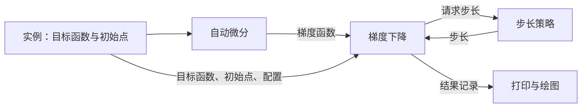

# 梯度下降法

这一专题分成两部分：**模块保存通用方法，实例定义具体问题并把模块连接起来。**
先读 `实例/一维函数.py`：它按五个步骤完整展示了一次求解。

## 文件放在哪里

```text
梯度下降法/
├── 模块/                   # 换一道题时可以继续使用
│   ├── 自动微分.py         # 从 f 得到梯度函数 grad_f
│   ├── 步长策略.py         # 决定每一步走多远
│   ├── 梯度下降.py         # 重复：求梯度 → 选步长 → 更新参数
│   ├── 结果记录.py         # 保存答案和每一步的记录
│   ├── 绘图.py             # 把结果画成曲线或轨迹
│   └── __init__.py         # 方便导入常用函数
├── 实例/                   # 一道问题一个文件
│   ├── 一维函数.py         # 从这里开始读
│   ├── 二维函数.py         # 二维二次函数及等高线轨迹
│   ├── 二次型.py           # 五维问题，与解析解比较
│   ├── 步长比较.py         # 同一道题换不同步长
│   └── __init__.py
├── tests/                  # 自动检查程序正确性
├── docs/                   # 数学说明与验证结果
└── pyproject.toml          # 安装依赖和模块
```

## 模块怎样拼起来

1. 实例定义 `objective(w)` 和初始向量 `w0`。
2. `make_gradient(objective)` 返回梯度函数 `grad_f`。
3. 实例把 `objective`、`w0`、`grad_f` 和步长配置交给 `gradient_descent`。
4. 求解器每轮调用 `choose_step`，然后执行 `w_next = w - alpha_k * grad_f(w)`。
5. 求解器返回 `result`；实例打印它，并交给绘图模块。



建议阅读顺序：`实例/一维函数.py` → `模块/梯度下降.py` →
`模块/步长策略.py` → `模块/自动微分.py`。结果和绘图模块可以在需要时查看。

## 安装和运行

Python 3.10 或以上。在仓库根目录进入专题：

```powershell
cd 最优化/梯度下降法
python -m venv .venv
.venv\Scripts\python.exe -m pip install -e ".[dev]"
.venv\Scripts\python.exe -m 实例.一维函数
```

运行后会打印答案并显示图。其他实例的运行命令是：

```powershell
.venv\Scripts\python.exe -m 实例.二维函数
.venv\Scripts\python.exe -m 实例.二次型
.venv\Scripts\python.exe -m 实例.步长比较
```

在 macOS / Linux 上，将 `.venv\Scripts\python.exe` 换成 `.venv/bin/python`。
NumPy 用于数组，Autograd 用于求梯度，SciPy 用于有界步长搜索，Matplotlib 用于绘图。

## 换成自己的题目

复制 `实例/一维函数.py`，修改目标函数、初始点和求解配置。例如：

```python
import autograd.numpy as np
from 模块.自动微分 import make_gradient
from 模块.梯度下降 import gradient_descent

# f: R^n → R；w 是一维数组，函数返回一个实数。
def objective(w):
    return np.sum((w - 3.0)**2)

result = gradient_descent(
    objective,
    w0=[2.0, -1.0],
    gradient=make_gradient(objective),
    step="fixed",
    alpha=0.1,
)
print(result.x)
```

目标函数内的数组运算使用 `autograd.numpy`，避免把参与求导的量强制转换成
`float`。如果已经有解析梯度，可以把自己的 `grad_f(w)` 直接传给 `gradient`。
省略 `gradient` 时，求解器也会自动调用 `make_gradient`。

改变参数个数时，轨迹图也要选择对应的维数：一维用 `plot_trajectory_1d`，
二维用 `plot_trajectory_2d`；任意维数都可以使用 `plot_convergence`。

| step 配置 | 步长 | 主要参数 |
| --- | --- | --- |
| `"fixed"` | 每步相同 | `alpha` |
| `"diminishing"` | alpha / (k + 1) | `alpha` |
| `"bounded_search"` | 在 [0, alpha_max] 内数值搜索 | `alpha_max` |

## 怎样读结果

| 字段 | 含义 |
| --- | --- |
| `result.x` | 最终参数向量 |
| `result.fun` | 最终函数值 |
| `result.nit` | 实际更新次数 |
| `result.success` | 是否达到梯度容差 |
| `result.message` | 停止原因 |
| `result.history` | 全部迭代记录 |

历史包括初始点，所以每个记录数组都有 `nit + 1` 项。`history.x` 保存参数，
`history.fun` 保存函数值，`history.gradient_norm` 保存梯度长度，
`history.step_size` 保存走到各点的步长；初始点的步长记为 0。

绘图函数默认不显示图，设置 `show=True` 就会显示；设置 `save="图.png"`
可以保存图。`绘图.py` 与求解过程独立。

## 验证

```powershell
.venv\Scripts\python.exe -m pytest
.venv\Scripts\python.exe -m build
```

验证包括解析解对照、梯度核对、三种步长、停止条件、历史记录和绘图。
详细结果见 [实现报告](docs/implementation_report.md)，公式说明见
[数学背景](docs/mathematical_background.md)。

## 适用范围与限制

- 目前处理实数、无约束、可微的标量目标函数。
- 梯度很小表示接近驻点，不保证找到全局最小值。
- 固定或递减步长需要合适的尺度；有界数值搜索也不保证全局最优步长。
- 递减策略在当前一维例题中，1000 次更新后仍未达到梯度容差。
- 一维、二维问题可以画参数轨迹；高维问题可以画收敛曲线。
- 保存全部历史所需的内存随维数和迭代次数增长。

## 来源与后续方向

原型来自 *Machine Learning Refined: Foundations, Algorithms, and Applications*
相关练习；其中一维函数在原型中标注为 Exercise 3.5。
自动微分与有界搜索分别使用 Autograd 和 SciPy。
后续可以在步长模块中加入 Armijo 回溯。代码采用 MIT 许可。
